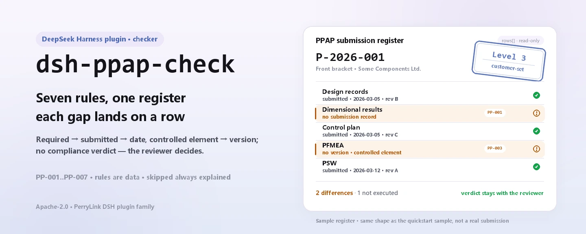

<div align="center">

<picture>
  <source media="(prefers-color-scheme: dark)" srcset="docs/assets/dsh-ppap-check-hero-en-dark.webp">
  
</picture>

# dsh-ppap-check

**Check a PPAP submission-element checklist for completeness and internal consistency — you get a list of which row, which column, and what to fix; the verdict stays with the reviewer.**

A data-only checker plugin for DeepSeek Harness: it reads one PPAP submission-element checklist (the part header plus one row per element), applies the versioned rule pack it ships (PP-001..PP-007), and lists only the differences it can point to inside the material — never a compliance verdict, never a liability finding.

[Install](#three-step-setup) · [Configuration](#configuration) · [FAQ](#faq) · [简体中文](README.md) · [English](README.en.md)

[](LICENSE)
[](#compatibility)
[](https://www.npmjs.com/package/dsh-ppap-check)
[](https://github.com/PerryLink/dsh-ppap-check/actions/workflows/ci.yml)
[](#compatibility)

[](https://github.com/PerryLink/dsh-ppap-check/stargazers)
[](https://www.npmjs.com/package/dsh-ppap-check)
[](https://dshfind.com/plugins/PerryLink/dsh-ppap-check?ref=badge)
[](https://securityscorecards.dev/viewer/?uri=github.com/PerryLink/dsh-ppap-check)
[](https://dsh.market/)
[](https://gitee.com/perrylink/dsh-ppap-check)

```sh
dsh plugin --profile <name> add dsh-ppap-check
```

</div>

<sub>Community plugin, not affiliated with DeepSeek. Canonical repository: <https://github.com/PerryLink/dsh-ppap-check> (Gitee is a mirror).</sub>

## What it is

`dsh-ppap-check` reads one PPAP submission-element checklist — the part header plus one row per element — and checks what a checklist can be held to mechanically: that an element the customer required carries a submission record, that a submitted element carries a date, that a controlled element (design record, FMEA, control plan, process flow, dimensional results, MSA) carries a revision, that the sheet names its part number and submission level, that element numbers are unique, and that no template placeholder survives in the element column.

It does not decide whether PPAP may be approved, whether the level is right, or whether an element's content satisfies the customer — the difference list goes to the reviewer.

- **Who it is for**: quality and supplier engineers; no command line required — hand the material over in chat.
- **What you give it**: the source material the check works on (a table, register, or document); the original is never modified. Excel can be converted to JSON/YAML first, in chat if the platform supports it.
- **What you get back**: a list of "which row, which column, what is missing, how to fix it"; every check that could not run is listed in `skipped` with its reason.

<picture>
  <source media="(prefers-color-scheme: dark)" srcset="docs/assets/dsh-ppap-check-flow-v5-dark.svg">
  
</picture>

## Three-step setup

1. **Install** (pick one channel):

   ```sh
   # git channel (latest main; equivalent to git+https://github.com/PerryLink/dsh-ppap-check.git)
   dsh plugin --profile <name> add github:PerryLink/dsh-ppap-check
   # npm channel (published releases)
   dsh plugin --profile <name> add dsh-ppap-check
   # tarball channel: pnpm pack in this repo, then
   dsh plugin --profile <name> add ./dsh-ppap-check-<version>.tgz
   ```

2. **Minimal config** (sane defaults; a bundle row without `config` uses every default, with the rule-pack path pointing at the bundled `rules/ppap-check.yaml`):

   ```yaml
   - insert:
       - id: dsh-ppap-check
         name: dsh-ppap-check
   ```

3. **Verify it mounts**:

   ```sh
   dsh --profile <name> --dump-config | grep 'dsh-ppap-check'
   ```

   Then hand it a checklist — for example the bundled sample (expected output in `samples/quickstart/expected/result.json`):

   ```text
   > Run this check on the bundled sample and tell me how many issues it found and their severities.
   ppap_check: 1 issue(s) — error 0, warn 1, info 0
   skipped: 1
   ```

**Uninstall**: `dsh plugin --profile <name> remove dsh-ppap-check` (or remove the row from the profile patch).

<details>
<summary>Use it in WorkBuddy / Coze</summary>

Search "Professional Document Check Suite" in WorkBuddy / Coze (the full set; this check is one part of it; availability as listed) to invoke the same checking capability without a command line.

</details>

<details>
<summary>Install from the DSH Desktop market</summary>

Every PerryLink plugin is listed in the built-in DSH Desktop market: **Market → Sources → Add source → paste** `https://perrylink-dsh-catalog.perrylink.workers.dev/catalog-source.json` **→ select**. Installation still requires the market's npm identity check and your confirmation.

</details>

## Core capabilities

`dsh-ppap-check` registers the `ppap_check` tool: it reads a submission-element checklist, applies a versioned rule pack, and returns a report.

- **Seven rules in one data pack** — the rule pack is data, not code (`rules/ppap-check.yaml`); replacing it switches the whole rule set without touching a line of TypeScript.
- **Read-only on the material** — accepts JSON or YAML and never modifies the original; pure ESM, no network requests and no model calls.
- **No fabricated citations** — every rule carries `document` / `number` / `clause` / `excerpt` / `kind` / `source`; `excerpt` must be a verbatim quotation, and rules whose clause text was not obtained this pass say so in the `excerpt` itself and stay marked `derived-from-principle`.
- **Severity follows the evidence** — `derived-from-principle` is capped at `warn`, institutional configuration (`institutional-configuration`) at `info`, and a test asserts it.
- **An empty issue list is never "nothing is wrong"** — every check that could not run is reported in `skipped` with its reason; a rule whose required list is unset reports itself in `skipped` rather than passing silently.
- **No adjudicating wording** — the report lists differences and never pronounces on compliance, liability, or correctness; a wording guard enforces this and every report carries the disclaimer.

| Rule | Check | Severity | Basis kind |
|---|---|---|---|
| `PP-001` | a required element has a submission record | warn | principle |
| `PP-002` | a submitted element carries a date | warn | principle |
| `PP-003` | a controlled element carries a revision | warn | principle |
| `PP-004` | the sheet names its part number and level | warn | principle |
| `PP-005` | the level comes from your customer's vocabulary (off by default) | info | local |
| `PP-006` | the element column holds no unreplaced placeholder | warn | principle |
| `PP-007` | element numbers are unique | warn | principle |

### Examples

These are the plugin's real entry points; install once, then call one. The first row below is the detailed walkthrough and the rest are short cases.

**Detailed example** — tool `ppap_check`, input:

```json
{"partNo":"P-2026-001","partName":"前支架","rows":[{"序号":"1","提交要素":"设计记录","是否要求":"是","是否提交":"是"},{"序号":"2","提交要素":"尺寸结果","是否要求":"是","是否提交":""}]}
```

Output:

```json
{
  "id": "dsh-ppap-check.PP-001.de02f9e1",
  "ruleId": "PP-001",
  "severity": "warn",
  "locator": {
    "row": 2,
    "field": "required"
  },
  "found": "第 2 行「required」为「是」，但缺 submitted",
  "expected": "满足该条件的行应同时填写 submitted",
  "fix": "补提交或说明未提交原因；本条只核对清单闭环，不判断要素内容是否合格"
}
```

*Observed from `dsh-ppap-check/tests/fixtures/PP-001/PP-001-unsafe.json (cases.json expects 1×PP-001); executed parseMaterial+runCheck, checkedAt=2026-10-06T00:00:00.000Z`*

| You ask | What it answers |
|---|---|
| An element is marked as required in the `required` column, but there is no submission record for it — is that reported? | Yes. `PP-001` reports the row when the `required` column holds a value that counts as required (`Y`, `yes`, `true`, `√`, or a local spelling configured in `conditionValues`) while the `submitted` column is empty. It reads that column of your own checklist, never a built-in element list — which elements are required depends on the level the customer specifies — and it does not judge whether the content of what was submitted is acceptable. |
| The row is marked as submitted, but the date cell is empty. And if the date is filled in but falls after the customer's deadline? | `PP-002` reports a row whose `submitted` column holds a value that counts as submitted (`Y`, `yes`, `true`, `√`, or a configured local spelling) while the `submittedAt` cell is blank. It only checks that the date cell is filled in — whether the date falls inside the deadline set by the customer's project plan is not checked. |
| The control plan row is filled in but its version cell is empty — will that be reported, and what about elements that carry no revision by nature? | `PP-003` looks at element names matching `conditionPattern` — design record, engineering change, DFMEA/PFMEA, control plan, process flow, dimensional results, measurement-system analysis, samples, checking aids, PSW, material reports, preliminary process capability — and reports each matching row whose `version` cell is empty. It only checks that the version is filled in, not that it is the correct or the current revision; narrow the pattern if an element genuinely carries no revision. |
| Every element row looks complete, but the tool says the sheet is missing the part number and the level. Our form records the level on each row instead. | `PP-004` reads the header only: `partNo` and `level` must both be present at the top of the material. If your form keeps the level on the detail rows, change this rule's `fields` or write a check of your own — the rule does not look for those values inside the rows. |
| The level cell reads `Level 3`, but `PP-005` never says anything about it. | `PP-005` ships with an empty `values` list, and empty means unconfigured, so it reports itself in `skipped` instead of passing quietly. Put your customer's level spellings into `values` and it will report any value that is not on the list. Even then it only checks that the value is on your list — whether the level chosen is the right one is the customer's decision — which is why the rule is capped at `info`. |
| Our checklist was copied from last year's template: one element name still holds an unreplaced placeholder and two rows carry the same element number. | `PP-006` reports an element name that still contains a placeholder — brackets, braces, `XXX`, `xxx`, `TBD`, `todo`, or a `terms` list you can adjust to your own template. `PP-007` reports a repeated element number in `elementNo`, comparing with whitespace ignored; a hit usually means the element was registered twice or the number was copied wrong, and which of the two it is has to be confirmed by a person. |

## Standards it follows

| Document | Number | Cited by rules |
|---|---|---|
| PPAP (Production Part Approval Process) Manual, AIAG (the canonical Chinese title is recorded in `rules/evidence/`) | AIAG PPAP (current edition and clause numbers not verified this pass) | PP-001, PP-002, PP-003, PP-004, PP-005, PP-006, PP-007 |

**Boundary:** this plugin checks a **PPAP submission-element checklist** for what a checklist can be held to mechanically — that an element the customer required carries a submission record, that a submitted element carries a date, that a controlled element (design record, FMEA, control plan, process flow, dimensional results, MSA) carries a revision, that the sheet names its part number and submission level, that element numbers are unique, and that no template placeholder survives. It does **not** decide whether PPAP may be approved, whether the level is right, or whether an element's content satisfies the customer. **The submission level is the customer's to set, and this plugin ships no level-to-element mapping.**

> ### ⚠️ Read this before trusting a citation in the report
>
> **Every `excerpt` in this plugin's rule pack says, in so many words, that the clause text was not obtained.** The method lives in the automotive **AIAG PPAP Manual** (and the customer-specific requirements under IATF 16949). The verification pass could not retrieve verbatim clause text, so rather than paraphrase a quotation the pack states the gap in the `excerpt` field itself and puts the honest reasoning in `note`. Every rule is therefore `warn` or `info`, and a test asserts that no rule claims a quotation it does not have. **When the text is in hand, two things must be done: replace each `excerpt` with the real clause, and raise `kind` to `direct`.**
>
> **Which elements must be submitted depends on the level the customer specifies** (Level 1–5), so `PP-001` reads the **checklist's own `required` column** rather than any built-in list, and `PP-005`'s level vocabulary ships **empty** — with no vocabulary configured it reports itself in `skipped` instead of passing quietly.

## Configuration

All tunables are Schemastery `Config` fields in `src/config.ts` (changeable from cordis.yml); the per-rule thresholds live in the rule pack under `rules/`. An id-targeted override replaces the whole row — restate every key you need.

| Key | Type | Default | Description |
|---|---|---|---|
| `rulesFile` | string | `rules/ppap-check.yaml` | Rule-pack path, relative to the package root |
| `disabledRules` | string[] | `[]` | Rule ids to stop running; each appears in `skipped` |
| `onlyRules` | string[] | `[]` | Run only these rule ids; empty runs every rule |
| `skipNotes` | string | `""` | Note appended to every `skipped` reason |
| `timeoutMs` | number | `120000` | Cooperative tool timeout budget |

Rule-level parameters worth knowing:

- `PP-001` `conditionValues` — the values in your `required` column that mean "required"; by default `Y`, `yes`, `true`, `√`, and the Chinese spellings listed in the rule pack.
- `PP-002` `conditionValues` — the values in your `submitted` column that mean "submitted".
- `PP-003` `conditionPattern` — the element names that carry revisions; the default covers design records, engineering changes, DFMEA/PFMEA, control plans, process flows, dimensional results, MSA, samples, checking aids, PSW, material reports, and preliminary capability studies.
- `PP-005` `values` — your customer's level spellings, e.g. `[Level 1, Level 2, Level 3, Level 4, Level 5]`. Empty means no check.

Example override in your profile patch:

```yaml
- insert:
    - id: dsh-ppap-check
      name: dsh-ppap-check
      config:
        disabledRules: [PP-005]
        timeoutMs: 180000
```

## Material format

The tool accepts JSON or YAML:

```yaml
partNo: P-2026-001
partName: 前支架
supplier: 某某零部件有限公司
level: Level 3
rows:
  - { 序号: '1', 提交要素: 设计记录, 是否要求: 是, 是否提交: 是,
      提交日期: 2026-03-05, 版本: B, 责任人: 张工 }
```

Column names are matched case-insensitively and ignoring spaces, underscores and hyphens; the sheet's own column names are kept, so a finding names the column it read. Fields are optional at the reader layer and validated by the check engine, so a partial export produces "missing item" findings instead of crashing.

## Rule sources

Rule data lives in `rules/ppap-check.yaml`, separated from the code: every rule carries a document, number, clause number in the source's own numbering, a verbatim excerpt, and a source URL. The load-time guard normally enforces "an excerpt must be a real quotation of at least eight characters", but it cannot tell a quotation from a description — so this pack leans on the header, the per-rule notes, and a test asserting that every `excerpt` admits the gap. A pack that overstates its basis fails on load instead of producing a confident-looking report.

The AIAG manual is a commercial publication whose public channels carry only the copyright notice and table of contents, not the body text; `kind` staying at `derived-from-principle` is therefore by design, not unfinished technical debt. The boundaries confirmed during verification and the conclusions deliberately **not** asserted ship in `rules/evidence/`.

## FAQ

<details>
<summary>Does it decide compliance for us?</summary>

No. It only lists the differences it can point to inside the material (which row, which column, what is missing, how to fix it) and does not decide facts or compliance — the conclusion always stays with the reviewer. A wording guard enforces the report wording, and every report carries the disclaimer.

</details>

<details>
<summary>My checklist is an Excel file. Can I use it directly?</summary>

Yes — convert it to JSON or YAML first; the platform can do the conversion in chat if it supports it. The tool only reads the material and never modifies the original.

</details>

<details>
<summary>Why does `PP-005` never report anything?</summary>

Because the pack ships no level vocabulary: `values` is empty by default, so the rule reports itself in `skipped`. Fill `values` with your customer's level spellings and the rule starts checking that the recorded level is on the list; it still does not judge whether the level chosen is correct.

</details>

<details>
<summary>Can an empty `issues` list be read as "nothing is wrong"?</summary>

No. Every check that could not run appears in `skipped` with its reason (an empty level vocabulary, a missing column). Read `issues` and `skipped` together before drawing any conclusion from a report.

</details>

<details>
<summary>Does it hold up when a whole project's checklists are checked at once?</summary>

The tool works in both `native` and `ptc` modes; for batch work (a whole project or a whole directory) use `ptc`, where the schema cost is paid once. The checks themselves are local column matching and date comparison: no network requests and no model calls; `timeoutMs` (120 s by default) is the cooperative timeout budget.

</details>

<details>
<summary>Is the material uploaded or used for training?</summary>

No. The plugin does not use the network, does not call a model, only reads the material, and never writes back to the original; the report is produced locally.

</details>

## Troubleshooting

- **`PP-005` never runs.** Its level vocabulary is empty. Level spellings differ between customers, so the plugin will not guess them.
- **`PP-001` fires on an element I do not intend to submit.** The `required` column says it is required. If the element is not required at your customer's level, correct that column rather than deleting the row.
- **`PP-003` fires on an element with no revision.** The element's name matches the pattern but the version column is empty. Narrow `conditionPattern` if your checklist has an element that genuinely carries no revision.
- **The plugin installs but the tool never appears.** Check that `main` resolves to `lib/index.mjs` and that `pnpm run build` produced it; a wrong `main` makes the loader skip the entry silently.
- **`dsh plugin add` refuses the package as incompatible.** The peer range covers `0.1.x` and `0.2.x`; if your runtime sits outside it, grant an explicit exemption: `dsh plugin --profile <name> allow-version dsh-ppap-check@0.1.0 --dsh-version <runtime> --accept-risk`
- **`check` reports `manifest-peers` as failed.** The static checker compares against a hard-coded peer range that predates the 0.2 line. The runtime enforces peer compatibility at install time, so the declared range is the correct one; this is a known upstream issue in `dsh-plugin-dev`.
- **Times look shifted.** All arithmetic is wall-clock on the input strings, with no timezone conversion.

## Compatibility

| Surface | Status |
|---|---|
| Harness | Peer range `>=0.1.2-rc.1 <0.2.0 \|\| >=0.2.0-0 <0.3.0` — verified to accept both `0.2.0-rc.2` and `0.2.1-rc.2`. `engines.dsh` is declared as `>=0.2.1-0 <0.3.0` and is enforced by the host since 0.2.1 |
| Node | `^22.19.0 \|\| >=24.0.0` |
| Platforms | All (plain ESM; no native code, no network, no model call) |
| Tool mode | Works in `native` and `ptc`; for several parts use `ptc` |

## Ecosystem & quality

- [Gitee mirror](https://gitee.com/perrylink/dsh-ppap-check) (sync mirror; GitHub is canonical)
- [dshfind plugin page](https://dshfind.com/plugins/PerryLink/dsh-ppap-check) (installs and ranking)
- [OpenSSF Scorecard report](https://securityscorecards.dev/viewer/?uri=github.com/PerryLink/dsh-ppap-check) (driven by [.github/workflows/scorecard.yml](.github/workflows/scorecard.yml))
- [DSH Market](https://dsh.market/) (listed)
- **1024 store channel**: `npm i -g dsh1024` once, then `dsh1024 plugin --profile <name> add dsh-ppap-check` (counts toward the [deepseek1024.com](https://deepseek1024.com) install ranking)
- [Ecosystem knowledge base](https://perrylink.github.io/dsh-plugin-guide/) — plugin development guide · plugin-selection data · maintenance criteria

## Development

```sh
pnpm install                                        # node ^22.19 || >=24
pnpm run typecheck                                  # tsc --noEmit
pnpm test                                           # vitest: shared table-plugin suite + paired fixtures
pnpm run build                                      # tsdown -> lib/index.mjs + lib/index.d.mts
pnpm run verify:self-contained                      # dependency specs resolve from the registry
pnpm run check:lockfile                             # lockfile drift check
pnpm run check:readmes                              # five-language README consistency
pnpm run check:citations                            # rule-pack citation baseline
node ../scripts/sync-shared.mjs dsh-ppap-check      # refresh src/shared from ../_shared
pnpm pack                                           # the published tarball
```

The plugin is **data-only**: `src/model.ts` declares the table shape, the shared kit supplies the reader and the check engine, and the rule pack declares every check. Local sample run (build `lib/` first):

```sh
node samples/quickstart/run.mjs --json
# => {"tool":"ppap_check","issueCount":1,"summary":{"error":0,"warn":1,"info":0},"skippedCount":1}
```

The sample input lives in `samples/quickstart/input/`, the expected output in `samples/quickstart/expected/result.json`, and a screenshot in `docs/assets/quickstart.png`. The README images are generated programmatically by [`scripts/gen-readme-assets.py`](scripts/gen-readme-assets.py) (Pillow for the hero, hand-written SVG for the structure diagram) and the script can be re-run; the old single-skin flow diagram and demo images stay in `docs/assets/` for external links, while the READMEs reference only the four new hero variants and the light/dark structure pair.

Topics: `deepseek-harness`, `dsh`, `dsh-plugin`, `cordis`, `ppap`

## Family & thanks

This project is part of the DeepSeek Harness plugin family from [PerryLink](https://github.com/PerryLink) (all Apache-2.0). Full family index: [choose a checker by material](https://perrylink.github.io/zh/checkers/choose/). If it is useful, **a star helps the next person find it** — nothing is gated behind it.

- [@PerryLink](https://github.com/PerryLink) — creator and maintainer: the data-only rule pack (PP-001..PP-007), the `ppap_check` tool, the citation-verification record, and the five-language docs.

<details>
<summary>Expand all plugins</summary>

| Plugin | Status |
|---|---|
| **[dsh-ppap-check](https://github.com/PerryLink/dsh-ppap-check)** |  |
| **[dsh-aqua-input-check](https://github.com/PerryLink/dsh-aqua-input-check)** |  |
| **[dsh-archive-check](https://github.com/PerryLink/dsh-archive-check)** |  |
| **[dsh-auto-review](https://github.com/PerryLink/dsh-auto-review)** |  |
| **[dsh-autotier](https://github.com/PerryLink/dsh-autotier)** | 🧊 FROZEN — see the repo README |
| **[dsh-bid-ca-precheck](https://github.com/PerryLink/dsh-bid-ca-precheck)** |  |
| **[dsh-bid-qual-check](https://github.com/PerryLink/dsh-bid-qual-check)** |  |
| **[dsh-cert-mcp](https://github.com/PerryLink/dsh-cert-mcp)** | 🧊 FROZEN — see the repo README |
| **[dsh-checkpoint-rewind](https://github.com/PerryLink/dsh-checkpoint-rewind)** |  |
| **[dsh-click](https://github.com/PerryLink/dsh-click)** |  |
| **[dsh-composer-history](https://github.com/PerryLink/dsh-composer-history)** |  |
| **[dsh-contract-stance](https://github.com/PerryLink/dsh-contract-stance)** |  |
| **[dsh-customs-doc-check](https://github.com/PerryLink/dsh-customs-doc-check)** |  |
| **[dsh-data-quality](https://github.com/PerryLink/dsh-data-quality)** | 🧊 FROZEN — see the repo README |
| **[dsh-demurrage-ledger](https://github.com/PerryLink/dsh-demurrage-ledger)** |  |
| **[dsh-doublecheck](https://github.com/PerryLink/dsh-doublecheck)** |  |
| **[dsh-drill-script-check](https://github.com/PerryLink/dsh-drill-script-check)** |  |
| **[dsh-eia-guide-check](https://github.com/PerryLink/dsh-eia-guide-check)** |  |
| **[dsh-emergency-plan](https://github.com/PerryLink/dsh-emergency-plan)** |  |
| **[dsh-essay-rubric-check](https://github.com/PerryLink/dsh-essay-rubric-check)** |  |
| **[dsh-evidence-check](https://github.com/PerryLink/dsh-evidence-check)** |  |
| **[dsh-export-ctl-check](https://github.com/PerryLink/dsh-export-ctl-check)** |  |
| **[dsh-fast](https://github.com/PerryLink/dsh-fast)** |  |
| **[dsh-fmea-table-check](https://github.com/PerryLink/dsh-fmea-table-check)** |  |
| **[dsh-forecast-penalty](https://github.com/PerryLink/dsh-forecast-penalty)** |  |
| **[dsh-fund-research](https://github.com/PerryLink/dsh-fund-research)** |  |
| **[dsh-github](https://github.com/PerryLink/dsh-github)** |  |
| **[dsh-gongwen-flow-check](https://github.com/PerryLink/dsh-gongwen-flow-check)** |  |
| **[dsh-gongwen-word-check](https://github.com/PerryLink/dsh-gongwen-word-check)** |  |
| **[dsh-guard-plan-qc](https://github.com/PerryLink/dsh-guard-plan-qc)** |  |
| **[dsh-hazchem-check](https://github.com/PerryLink/dsh-hazchem-check)** |  |
| **[dsh-hazplan-check](https://github.com/PerryLink/dsh-hazplan-check)** |  |
| **[dsh-hidden-risk-map](https://github.com/PerryLink/dsh-hidden-risk-map)** |  |
| **[dsh-hs-classify](https://github.com/PerryLink/dsh-hs-classify)** |  |
| **[dsh-icd-rule-check](https://github.com/PerryLink/dsh-icd-rule-check)** |  |
| **[dsh-industry-research](https://github.com/PerryLink/dsh-industry-research)** |  |
| **[dsh-lawcite-adapter](https://github.com/PerryLink/dsh-lawcite-adapter)** |  |
| **[dsh-laya](https://github.com/PerryLink/dsh-laya)** |  |
| **[dsh-lc-doc-check](https://github.com/PerryLink/dsh-lc-doc-check)** |  |
| **[dsh-learning-gap-check](https://github.com/PerryLink/dsh-learning-gap-check)** |  |
| **[dsh-library](https://github.com/PerryLink/dsh-library)** |  |
| **[dsh-local-ai](https://github.com/PerryLink/dsh-local-ai)** |  |
| **[dsh-lsp-actions](https://github.com/PerryLink/dsh-lsp-actions)** |  |
| **[dsh-mask](https://github.com/PerryLink/dsh-mask)** |  |
| **[dsh-mcp-panel](https://github.com/PerryLink/dsh-mcp-panel)** |  |
| **[dsh-medrec-qc](https://github.com/PerryLink/dsh-medrec-qc)** |  |
| **[dsh-memento](https://github.com/PerryLink/dsh-memento)** | 🧊 FROZEN — see the repo README |
| **[dsh-nsfc-form-check](https://github.com/PerryLink/dsh-nsfc-form-check)** |  |
| **[dsh-nurse-record-check](https://github.com/PerryLink/dsh-nurse-record-check)** |  |
| **[dsh-observe](https://github.com/PerryLink/dsh-observe)** |  |
| **[dsh-origin-rvc-check](https://github.com/PerryLink/dsh-origin-rvc-check)** |  |
| **[dsh-ota-review-check](https://github.com/PerryLink/dsh-ota-review-check)** |  |
| **[dsh-output-styles](https://github.com/PerryLink/dsh-output-styles)** |  |
| **[dsh-paper-doc-adapter](https://github.com/PerryLink/dsh-paper-doc-adapter)** |  |
| **[dsh-permission-rules](https://github.com/PerryLink/dsh-permission-rules)** |  |
| **[dsh-permit-report-check](https://github.com/PerryLink/dsh-permit-report-check)** |  |
| **[dsh-pipeline-check](https://github.com/PerryLink/dsh-pipeline-check)** |  |
| **[dsh-pleading-draft](https://github.com/PerryLink/dsh-pleading-draft)** |  |
| **[dsh-plugin-doctor](https://github.com/PerryLink/dsh-plugin-doctor)** | 🚫 RETIRED (repo archived) |
| **[dsh-plugin-guide](https://github.com/PerryLink/dsh-plugin-guide)** |  |
| **[dsh-plugin-kit](https://github.com/PerryLink/dsh-plugin-kit)** | 🚫 RETIRED (repo archived) |
| **[dsh-plugin-upgrade](https://github.com/PerryLink/dsh-plugin-upgrade)** | 🚫 RETIRED (repo archived) |
| **[dsh-policy-brief-draft](https://github.com/PerryLink/dsh-policy-brief-draft)** |  |
| **[dsh-power-loss-split](https://github.com/PerryLink/dsh-power-loss-split)** |  |
| **[dsh-power-ticket-check](https://github.com/PerryLink/dsh-power-ticket-check)** |  |
| **[dsh-protest-deadline](https://github.com/PerryLink/dsh-protest-deadline)** |  |
| **[dsh-railway-window](https://github.com/PerryLink/dsh-railway-window)** |  |
| **[dsh-repair-order-qc](https://github.com/PerryLink/dsh-repair-order-qc)** |  |
| **[dsh-research-report](https://github.com/PerryLink/dsh-research-report)** |  |
| **[dsh-review-reply-check](https://github.com/PerryLink/dsh-review-reply-check)** |  |
| **[dsh-rulefile-check](https://github.com/PerryLink/dsh-rulefile-check)** |  |
| **[dsh-safety-brief-check](https://github.com/PerryLink/dsh-safety-brief-check)** |  |
| **[dsh-score](https://github.com/PerryLink/dsh-score)** | 🧊 FROZEN — see the repo README |
| **[dsh-session-sync](https://github.com/PerryLink/dsh-session-sync)** |  |
| **[dsh-site-log-check](https://github.com/PerryLink/dsh-site-log-check)** |  |
| **[dsh-skill-pack-security](https://github.com/PerryLink/dsh-skill-pack-security)** |  |
| **[dsh-soe-decision-check](https://github.com/PerryLink/dsh-soe-decision-check)** |  |
| **[dsh-soilwater-check](https://github.com/PerryLink/dsh-soilwater-check)** |  |
| **[dsh-sop-sync-check](https://github.com/PerryLink/dsh-sop-sync-check)** |  |
| **[dsh-spc-gbt-adapter](https://github.com/PerryLink/dsh-spc-gbt-adapter)** |  |
| **[dsh-talk](https://github.com/PerryLink/dsh-talk)** |  |
| **[dsh-tender-extract](https://github.com/PerryLink/dsh-tender-extract)** |  |
| **[dsh-tender-matrix](https://github.com/PerryLink/dsh-tender-matrix)** |  |
| **[dsh-test-drive](https://github.com/PerryLink/dsh-test-drive)** |  |
| **[dsh-ticktick](https://github.com/PerryLink/dsh-ticktick)** | 🚫 RETIRED (repo archived) |
| **[dsh-translate](https://github.com/PerryLink/dsh-translate)** |  |
| **[dsh-warranty-calc](https://github.com/PerryLink/dsh-warranty-calc)** |  |
| **[dsh-budget](https://github.com/PerryLink/dsh-budget)** | 🧊 FROZEN — see the repo README |
| **[dsh-claude-move](https://github.com/PerryLink/dsh-claude-move)** | 🧊 FROZEN — see the repo README |
| **[dsh-defend](https://github.com/PerryLink/dsh-defend)** | 🧊 FROZEN — see the repo README |
| **[dsh-draw](https://github.com/PerryLink/dsh-draw)** | 🧊 FROZEN — see the repo README |
| **[dsh-reach](https://github.com/PerryLink/dsh-reach)** | 🧊 FROZEN — see the repo README |
| **[dsh-background-agents](https://github.com/PerryLink/dsh-background-agents)** | 🚫 RETIRED (repo archived) |
| **[dsh-session-pin](https://github.com/PerryLink/dsh-session-pin)** | 🚫 RETIRED (repo archived) |
| **[dsh-team-rooms](https://github.com/PerryLink/dsh-team-rooms)** | 🚫 RETIRED (repo archived) |

</details>

## License

[LICENSE](LICENSE) (Apache License 2.0) © 2026 dsh-ppap-check contributors

<p align="center"><sub>Apache-2.0 · Community plugin, not affiliated with DeepSeek.</sub></p>
