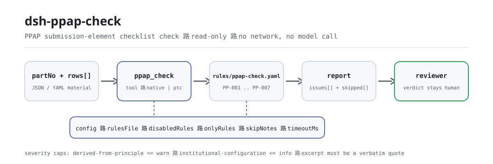

<div align="center">

<picture>
  <source media="(prefers-color-scheme: dark)" srcset="docs/assets/dsh-ppap-check-flow-dark.svg">
  
</picture>

# dsh-ppap-check

**Comprueba la completitud y la coherencia interna de una lista de elementos de presentación del PPAP: obtienes una lista de qué fila, qué columna y qué falta; el veredicto queda en manos del revisor.**

Un plugin verificador de solo datos para DeepSeek Harness: lee una lista de elementos de presentación del PPAP (la cabecera de la pieza más una fila por elemento), aplica el paquete de reglas versionado que incluye (PP-001..PP-007) y solo enumera las diferencias que puede señalar dentro del material — nunca un veredicto de cumplimiento, nunca una atribución de responsabilidad.

[Instalar](#instalación-en-tres-pasos) · [Configuración](#configuración) · [FAQ](#faq) · [简体中文](README.md) · [English](README.en.md) · [Español](README.es.md) · [Português](README.pt.md) · [हिन्दी](README.hi.md)

[](LICENSE)
[](#compatibilidad)
[](https://www.npmjs.com/package/dsh-ppap-check)
[](https://github.com/PerryLink/dsh-ppap-check/actions/workflows/ci.yml)
[](#compatibilidad)

[](https://github.com/PerryLink/dsh-ppap-check/stargazers)
[](https://www.npmjs.com/package/dsh-ppap-check)
[](https://dshfind.com/plugins/PerryLink/dsh-ppap-check?ref=badge)
[](https://securityscorecards.dev/viewer/?uri=github.com/PerryLink/dsh-ppap-check)
[](https://dsh.market/)
[](https://gitee.com/perrylink/dsh-ppap-check)

```sh
dsh plugin --profile <name> add dsh-ppap-check
```

</div>

<sub>Plugin de la comunidad, no afiliado a DeepSeek. Repositorio canónico: <https://github.com/PerryLink/dsh-ppap-check> (Gitee es un espejo).</sub>

## Qué es

`dsh-ppap-check` lee una lista de elementos de presentación del PPAP —la cabecera de la pieza más una fila por elemento— y comprueba lo que a una lista se le puede exigir mecánicamente: que un elemento requerido por el cliente lleve un registro de presentación, que un elemento presentado lleve fecha, que un elemento controlado (registro de diseño, FMEA, plan de control, diagrama de flujo del proceso, resultados dimensionales, MSA) lleve una revisión, que la hoja indique su número de pieza y su nivel de presentación, que los números de elemento sean únicos y que no sobreviva ningún marcador de plantilla en la columna del elemento.

No decide si el PPAP puede aprobarse, si el nivel es el correcto ni si el contenido de un elemento satisface al cliente: la lista de diferencias pasa al revisor.

- **Para quién es**: ingenieros de calidad y de proveedores; no hace falta línea de comandos, basta entregar el material en el chat.
- **Qué entrega usted**: el material fuente sobre el que trabaja la comprobación (una tabla, una lista o un documento); el original nunca se modifica. Excel puede convertirse antes a JSON/YAML, en el propio chat si la plataforma lo permite.
- **Qué recibe**: una lista de «qué fila, qué columna, qué falta, cómo corregirlo»; cada comprobación que no pudo ejecutarse aparece en `skipped` con su motivo.

## Instalación en tres pasos

1. **Instale** (elija un canal):

   ```sh
   # canal git (main más reciente; equivalente a git+https://github.com/PerryLink/dsh-ppap-check.git)
   dsh plugin --profile <name> add github:PerryLink/dsh-ppap-check
   # canal npm (versiones publicadas)
   dsh plugin --profile <name> add dsh-ppap-check
   # canal tarball: pnpm pack en este repo y después
   dsh plugin --profile <name> add ./dsh-ppap-check-<version>.tgz
   ```

2. **Configuración mínima** (valores por defecto listos para usar; una fila bundle sin `config` aplica todos los valores por defecto y la ruta del paquete de reglas apunta al `rules/ppap-check.yaml` incluido):

   ```yaml
   - insert:
       - id: dsh-ppap-check
         name: dsh-ppap-check
   ```

3. **Verifique que se monta**:

   ```sh
   dsh --profile <name> --dump-config | grep 'dsh-ppap-check'
   ```

   Después entréguele una lista —por ejemplo la muestra incluida en el repositorio (salida esperada en `samples/quickstart/expected/result.json`):

   ```text
   > Ejecuta esta comprobación con la muestra incluida y dime cuántos hallazgos hay y de qué nivel.
   ppap_check: 1 issue(s) — error 0, warn 1, info 0
   skipped: 1
   ```

**Desinstalar**: `dsh plugin --profile <name> remove dsh-ppap-check` (o elimine la fila del patch del perfil).

<details>
<summary>Usarlo en WorkBuddy / Coze</summary>

Busque «Professional Document Check Suite» en WorkBuddy / Coze (el conjunto completo; esta comprobación es una parte; disponibilidad según la tienda) para invocar la misma capacidad de verificación sin línea de comandos.

</details>

<details>
<summary>Instalar desde el mercado de DSH Desktop</summary>

Todos los plugins de PerryLink se pueden explorar en el mercado integrado de DSH Desktop: **Mercado → Fuentes → Añadir fuente → pegue** `https://perrylink-dsh-catalog.perrylink.workers.dev/catalog-source.json` **→ seleccione**. La instalación sigue requiriendo la verificación de identidad npm del mercado y su confirmación.

</details>

## Capacidades clave

`dsh-ppap-check` registra la herramienta `ppap_check`: lee una lista de elementos de presentación, aplica un paquete de reglas versionado y devuelve un informe.

- **Siete reglas en un paquete de datos** — el paquete de reglas es datos, no código (`rules/ppap-check.yaml`); sustituirlo cambia todo el conjunto de reglas sin tocar una línea de TypeScript.
- **Solo lectura sobre el material** — acepta JSON o YAML y nunca modifica el original; ESM puro, sin peticiones de red y sin llamadas al modelo.
- **Sin citas inventadas** — cada regla lleva `document` / `number` / `clause` / `excerpt` / `kind` / `source`; `excerpt` debe ser una cita literal, y las reglas cuyo texto de cláusula no se pudo obtener esta vez lo dicen en el propio `excerpt` y permanecen marcadas como `derived-from-principle`.
- **La severidad sigue a la evidencia** — `derived-from-principle` tiene como tope `warn`, la configuración institucional (`institutional-configuration`) tiene como tope `info`, y un test lo garantiza.
- **Una lista vacía nunca es «todo está bien»** — cada comprobación que no pudo ejecutarse se informa en `skipped` con su motivo; una regla cuya lista obligatoria no está configurada se autoinforma en `skipped` en lugar de pasar en silencio.
- **Sin redacción adjudicadora** — el informe enumera diferencias y nunca se pronuncia sobre cumplimiento, responsabilidad o corrección; un guardián de redacción (wording guard) lo impone y cada informe lleva el descargo.

| Regla | Comprobación | Severidad | Tipo de base |
|---|---|---|---|
| `PP-001` | un elemento exigido tiene registro de presentación | warn | principle |
| `PP-002` | un elemento presentado lleva fecha | warn | principle |
| `PP-003` | un elemento controlado lleva revisión | warn | principle |
| `PP-004` | la hoja indica número de pieza y nivel | warn | principle |
| `PP-005` | el nivel proviene del vocabulario de su cliente (desactivada por defecto) | info | local |
| `PP-006` | la columna del elemento no conserva marcadores sin sustituir | warn | principle |
| `PP-007` | los números de elemento son únicos | warn | principle |

### Ejemplos

Estos son los puntos de entrada reales del plugin; instálelo una vez e invoque uno. La primera fila de la tabla siguiente es el recorrido detallado y las demás son casos breves.

**Ejemplo detallado** — herramienta `ppap_check`, entrada:

```json
{"partNo":"P-2026-001","partName":"前支架","rows":[{"序号":"1","提交要素":"设计记录","是否要求":"是","是否提交":"是"},{"序号":"2","提交要素":"尺寸结果","是否要求":"是","是否提交":""}]}
```

Salida:

```json
{
  "id": "dsh-ppap-check.PP-001.de02f9e1",
  "ruleId": "PP-001",
  "severity": "warn",
  "locator": {
    "row": 2,
    "field": "required"
  },
  "found": "第 2 行「required」为「是」，但缺 submitted",
  "expected": "满足该条件的行应同时填写 submitted",
  "fix": "补提交或说明未提交原因；本条只核对清单闭环，不判断要素内容是否合格"
}
```

*Observado en `dsh-ppap-check/tests/fixtures/PP-001/PP-001-unsafe.json (cases.json expects 1×PP-001); executed parseMaterial+runCheck, checkedAt=2026-10-06T00:00:00.000Z`*

| Usted pregunta | Qué responde |
|---|---|
| Un elemento está marcado como requerido en la columna 是否要求, pero no tiene registro de presentación, ¿se informa? | Sí. `PP-001` señala la fila cuando la columna `required` contiene un valor que cuenta como requerido (`是`, `Y`, `yes`, `true`, `要求`, `√`) y la columna `submitted` está vacía. Lee esa columna de su propia lista, nunca un catálogo de elementos incorporado —qué elementos se exigen depende del nivel que indique el cliente— y no juzga si el contenido de lo presentado es aceptable. |
| La fila figura como presentada, pero la celda de fecha está vacía. ¿Y si la fecha está puesta pero cae después del plazo del cliente? | `PP-002` señala la fila cuya columna `submitted` contiene un valor que cuenta como presentado (`是`, `Y`, `yes`, `true`, `已提交`, `√`) y cuya celda `submittedAt` está en blanco. Solo comprueba que la celda de la fecha esté rellena: no comprueba si la fecha cae dentro del plazo que fija el plan de proyecto del cliente. |
| La fila del plan de control está rellena pero su celda de versión está vacía, ¿se informa? ¿Y los elementos que por naturaleza no llevan versión? | `PP-003` mira los nombres de elemento que coinciden con `conditionPattern` —registro de diseño, cambio de ingeniería, DFMEA/PFMEA, plan de control, diagrama de flujo del proceso, resultados dimensionales, análisis del sistema de medición, muestras, auxiliares de verificación, PSW, informes de material, capacidad inicial del proceso— e informa cada fila coincidente cuya celda `version` esté vacía. Solo comprueba que la versión esté rellena, no que sea la correcta o la vigente; si un elemento realmente no lleva versión, restrinja el patrón. |
| Todas las filas de elementos parecen completas, pero la herramienta dice que falta el número de pieza y el nivel. En nuestro formulario el nivel va en cada fila. | `PP-004` lee solo la cabecera: `partNo` y `level` deben estar ambos en la parte superior del material. Si su formulario guarda el nivel en las filas de detalle, cambie los `fields` de esta regla o escriba una comprobación propia: la regla no busca esos valores dentro de las filas. |
| La celda del nivel dice `Level 3`, pero `PP-005` no dice nada al respecto. | `PP-005` viene con la lista `values` vacía, y vacía significa sin configurar, así que se informa a sí misma en `skipped` en lugar de pasar en silencio. Ponga en `values` las grafías de nivel de su cliente y señalará cualquier valor que no esté en la lista. Aun así solo comprueba que el valor esté en su lista —si el nivel elegido es el correcto lo decide el cliente—, y por eso está limitada a `info`. |
| Nuestra lista se copió de la plantilla del año pasado: un nombre de elemento todavía contiene un marcador sin sustituir y dos filas llevan el mismo número de elemento. | `PP-006` señala un nombre de elemento que aún contiene un marcador —corchetes, llaves, `XXX`, `xxx`, `TBD`, `todo`, o una lista `terms` ajustable a su plantilla—. `PP-007` señala un número de elemento repetido en `elementNo`, comparando con los espacios en blanco ignorados; un hallazgo suele significar que el elemento se registró dos veces o que el número se copió mal, y cuál de las dos cosas es debe confirmarlo una persona. |

## Normas que sigue

| Documento | Número | Reglas que lo citan |
|---|---|---|
| 《生产件批准程序（PPAP）手册》 | AIAG PPAP（现行版次与条号本次未核实） | PP-001, PP-002, PP-003, PP-004, PP-005, PP-006, PP-007 |

**Límite:** este plugin comprueba lo que a una **lista de elementos de presentación del PPAP** se le puede exigir mecánicamente — que un elemento requerido por el cliente lleve registro de presentación, que un elemento presentado lleve fecha, que un elemento controlado (registro de diseño, FMEA, plan de control, diagrama de flujo del proceso, resultados dimensionales, MSA) lleve una revisión, que la hoja indique número de pieza y nivel de presentación, que los números de elemento sean únicos y que no sobreviva ningún marcador de plantilla. **No** decide si el PPAP puede aprobarse, si el nivel es correcto ni si el contenido de un elemento satisface al cliente. **El nivel de presentación lo fija el cliente y este plugin no incluye ninguna correspondencia entre nivel y elementos.**

> ### ⚠️ Lea esto antes de fiarse de una cita del informe
>
> **Cada `excerpt` del paquete de reglas de este plugin dice, con todas las letras, que el texto de la cláusula no se obtuvo.** El método vive en el **Manual PPAP de AIAG** del sector automotriz (y en los requisitos específicos del cliente bajo IATF 16949). La pasada de verificación no pudo recuperar el texto literal de la cláusula, así que en lugar de parafrasear una cita el paquete declara la laguna en el propio campo `excerpt` y pone el razonamiento honesto en `note`. Por eso todas las reglas son `warn` o `info`, y un test garantiza que ninguna regla afirme una cita que no tiene. **Cuando el texto esté en mano, hay que hacer dos cosas: sustituir cada `excerpt` por la cláusula real y elevar `kind` a `direct`.**
>
> **Qué elementos deben presentarse depende del nivel que indique el cliente** (Level 1–5), así que `PP-001` lee la **columna `required` de la propia lista**, no una lista incorporada, y el vocabulario de niveles de `PP-005` viene **vacío**: sin vocabulario configurado se informa a sí mismo en `skipped` en lugar de pasar en silencio.

## Configuración

Todos los parámetros ajustables son campos `Config` de Schemastery en `src/config.ts` (modificables desde cordis.yml); los umbrales por regla viven en el paquete de reglas bajo `rules/`. Una sustitución por id reemplaza la fila entera: repita todas las claves que necesite.

| Clave | Tipo | Predeterminado | Descripción |
|---|---|---|---|
| `rulesFile` | string | `rules/ppap-check.yaml` | Ruta del paquete de reglas, relativa a la raíz del paquete |
| `disabledRules` | string[] | `[]` | Ids de reglas que se dejan de ejecutar; cada una aparece en `skipped` |
| `onlyRules` | string[] | `[]` | Ejecutar solo estas reglas; vacío ejecuta todas |
| `skipNotes` | string | `""` | Nota añadida a cada motivo de `skipped` |
| `timeoutMs` | number | `120000` | Presupuesto de tiempo de espera cooperativo de la herramienta |

Parámetros por regla que conviene conocer:

- `PP-001` `conditionValues` — los valores de su columna `required` que significan «requerido»; por defecto `[是, Y, yes, true, 要求, √]`.
- `PP-002` `conditionValues` — los valores de su columna `submitted` que significan «presentado».
- `PP-003` `conditionPattern` — los nombres de elemento que llevan revisión; el valor por defecto cubre registros de diseño, cambios de ingeniería, DFMEA/PFMEA, planes de control, diagramas de flujo del proceso, resultados dimensionales, MSA, muestras, auxiliares de verificación, PSW, informes de material y capacidad inicial del proceso.
- `PP-005` `values` — las grafías de nivel de su cliente, por ejemplo `[Level 1, Level 2, Level 3, Level 4, Level 5]`. Vacío significa sin comprobación.

Ejemplo de sustitución en el patch de su perfil:

```yaml
- insert:
    - id: dsh-ppap-check
      name: dsh-ppap-check
      config:
        disabledRules: [PP-005]
        timeoutMs: 180000
```

## Formato del material

La herramienta acepta JSON o YAML:

```yaml
partNo: P-2026-001
partName: 前支架
supplier: 某某零部件有限公司
level: Level 3
rows:
  - { 序号: '1', 提交要素: 设计记录, 是否要求: 是, 是否提交: 是,
      提交日期: 2026-03-05, 版本: B, 责任人: 张工 }
```

Los nombres de columna se cotejan sin distinguir mayúsculas e ignorando espacios, guiones bajos y guiones; se conservan los nombres propios de la lista, de modo que un hallazgo nombra la columna que leyó. Los campos son opcionales en la capa de lectura y los valida el motor de comprobación, de modo que una exportación parcial produce hallazgos de «elemento ausente» en lugar de un fallo.

## Fuentes de las reglas

Los datos de las reglas están separados del código, y cada regla lleva documento, número, cláusula en la numeración propia de la fuente, extracto literal y URL de origen. El cargador impone que el extracto sea una cita real de al menos ocho caracteres y que una comprobación basada sólo en un principio general (`kind: derived-from-principle`, tope `warn`) o en una política local (`kind: institutional-configuration`, tope `info`) nunca se declare `error`. Un paquete que exagere su base falla al cargar en lugar de producir un informe con aspecto seguro.

El manual de AIAG es una publicación comercial cuyos canales públicos solo ofrecen el aviso de copyright y el índice, no el cuerpo del texto; por eso `kind` se mantiene en `derived-from-principle` por diseño, no por deuda técnica pendiente. Los límites confirmados durante la verificación y las conclusiones deliberadamente **no** afirmadas están en `rules/evidence/`.

## FAQ

<details>
<summary>¿Decide el cumplimiento por nosotros?</summary>

No. Solo enumera las diferencias que puede señalar dentro del material (qué fila, qué columna, qué falta, cómo corregirlo) y no decide hechos ni cumplimiento: la conclusión queda siempre en manos del revisor. Un guardián de redacción impone la redacción del informe y cada informe lleva el descargo.

</details>

<details>
<summary>Mi lista es un Excel. ¿Puedo usarla directamente?</summary>

Sí: conviértala antes a JSON o YAML; en el chat la plataforma puede hacer la conversión por usted si lo permite. La herramienta solo lee el material y nunca modifica el original.

</details>

<details>
<summary>¿Por qué `PP-005` nunca informa de nada?</summary>

Porque el paquete no trae ningún vocabulario de niveles: `values` viene vacío de fábrica, así que la regla se autoinforma en `skipped`. Rellene `values` con las grafías de nivel de su cliente y la regla empezará a comprobar que el nivel registrado esté en la lista; sigue sin juzgar si el nivel elegido es el correcto.

</details>

<details>
<summary>¿Una lista `issues` vacía puede leerse como «nada va mal»?</summary>

No. Cada comprobación que no pudo ejecutarse aparece en `skipped` con su motivo (un vocabulario de niveles vacío, una columna ausente). Lea `issues` y `skipped` juntos antes de sacar cualquier conclusión de un informe.

</details>

<details>
<summary>¿Aguanta un proyecto entero de listas a la vez?</summary>

La herramienta funciona en los modos `native` y `ptc`; para trabajo por lotes (un proyecto completo o un directorio entero) use `ptc`, donde el coste del esquema se paga una sola vez. Las comprobaciones en sí son cotejo de columnas y comparación de fechas locales: sin peticiones de red y sin llamadas al modelo; `timeoutMs` (120 s por defecto) es el presupuesto de tiempo de espera cooperativo.

</details>

<details>
<summary>¿El material se sube a internet o se usa para entrenar?</summary>

No. El plugin no usa la red, no llama a ningún modelo, solo lee el material y nunca escribe en el original; el informe se genera en local.

</details>

## Solución de problemas

- **`PP-005` nunca se ejecuta.** Su vocabulario de niveles está vacío. Las grafías difieren entre clientes, así que el plugin no las adivina.
- **`PP-001` salta sobre un elemento que no pienso presentar.** La columna `required` dice que es requerido. Si el elemento no se exige en el nivel de su cliente, corrija esa columna en lugar de borrar la fila.
- **`PP-003` salta sobre un elemento sin revisión.** El nombre coincide con el patrón y la columna de versión está vacía. Si su lista tiene un elemento que realmente no lleva versión, restrinja `conditionPattern`.
- **El plugin se instala pero la herramienta no aparece.** Compruebe que `main` resuelve a `lib/index.mjs` y que `pnpm run build` lo generó; un `main` erróneo hace que el cargador omita la entrada en silencio.
- **`dsh plugin add` rechaza el paquete por incompatible.** El rango de peers cubre `0.1.x` y `0.2.x`; si su runtime queda fuera, conceda una exención explícita: `dsh plugin --profile <name> allow-version dsh-ppap-check@0.1.0 --dsh-version <runtime> --accept-risk`
- **`check` informa `manifest-peers` como fallo.** El verificador estático compara contra un rango de peers fijado en el código, anterior a la línea 0.2. El runtime impone la compatibilidad al instalar, así que el rango declarado es el correcto; es un problema conocido en origen de `dsh-plugin-dev`.
- **Las horas parecen desplazadas.** Toda la aritmética es de reloj local sobre las cadenas entregadas, sin conversión de zona horaria.

## Compatibilidad

| Superficie | Estado |
|---|---|
| Harness | Rango de peers `>=0.1.2-rc.1 <0.2.0 \|\| >=0.2.0-0 <0.3.0` — verificado para aceptar tanto `0.2.0-rc.2` como `0.2.1-rc.2`. `engines.dsh` se declara como `>=0.2.1-0 <0.3.0` y el host lo aplica desde 0.2.1 |
| Node | `^22.19.0 \|\| >=24.0.0` |
| Plataformas | Todas (ESM puro; sin código nativo, sin red, sin llamada al modelo) |
| Modo de herramienta | Funciona en `native` y `ptc`; para un directorio completo use `ptc` |

## Ecosistema y calidad

- [Espejo de Gitee](https://gitee.com/perrylink/dsh-ppap-check) (espejo sincronizado; GitHub es el canónico)
- [Página del plugin en dshfind](https://dshfind.com/plugins/PerryLink/dsh-ppap-check) (instalaciones y clasificación)
- [Informe de OpenSSF Scorecard](https://securityscorecards.dev/viewer/?uri=github.com/PerryLink/dsh-ppap-check) (impulsado por [.github/workflows/scorecard.yml](.github/workflows/scorecard.yml))
- [DSH Market](https://dsh.market/) (listado)
- **Canal de la tienda 1024**: `npm i -g dsh1024` una vez, luego `dsh1024 plugin --profile <name> add dsh-ppap-check` (cuenta para la clasificación de instalaciones de [deepseek1024.com](https://deepseek1024.com))
- [Base de conocimiento del ecosistema](https://perrylink.github.io/dsh-plugin-guide/) — guía de desarrollo de plugins · datos medidos de selección · criterios de mantenimiento

## Desarrollo

```sh
pnpm install                                        # node ^22.19 || >=24
pnpm run typecheck                                  # tsc --noEmit
pnpm test                                           # vitest: suite compartida de plugins de tablas + fixtures pareados
pnpm run build                                      # tsdown -> lib/index.mjs + lib/index.d.mts
pnpm run verify:self-contained                      # las specs de dependencias se resuelven desde el registry
pnpm run check:lockfile                             # deriva del lockfile
pnpm run check:readmes                              # coherencia de los cinco README
pnpm run check:citations                            # línea base de citas del paquete de reglas
node ../scripts/sync-shared.mjs dsh-ppap-check      # refresca src/shared desde ../_shared
pnpm pack                                           # el tarball publicado
```

El plugin es **de solo datos**: `src/model.ts` declara la forma de la tabla, el kit compartido aporta el lector y el motor de comprobación, y el paquete de reglas declara cada verificación. Ejecución local de la muestra (requiere `pnpm run build` primero para producir `lib/`):

```sh
node samples/quickstart/run.mjs --json
# => {"tool":"ppap_check","issueCount":1,"summary":{"error":0,"warn":1,"info":0},"skippedCount":1}
```

La entrada de muestra vive en `samples/quickstart/input/`, la salida esperada en `samples/quickstart/expected/result.json` y una captura en `docs/assets/quickstart.png`. Las imágenes del README se generan programáticamente con [`scripts/gen-readme-assets.py`](scripts/gen-readme-assets.py) (Python + Pillow) y el script puede reejecutarse; el diagrama de flujo antiguo de una sola piel y las imágenes de demostración se conservan en `docs/assets/` para los enlaces externos, mientras que los README solo referencian el nuevo par claro/oscuro.

Topics: `deepseek-harness`, `dsh`, `dsh-plugin`, `cordis`, `ppap`

## Familia y agradecimientos

Este proyecto forma parte de la familia de plugins de DeepSeek Harness de [PerryLink](https://github.com/PerryLink) (todos Apache-2.0). Índice completo de la familia: [elija un verificador por material](https://perrylink.github.io/zh/checkers/choose/). Si le resulta útil, **una estrella ayuda a que la siguiente persona lo encuentre** — no hay nada bloqueado tras ella.

- [@PerryLink](https://github.com/PerryLink) — creador y mantenedor: el paquete de reglas de solo datos (PP-001..PP-007), la herramienta `ppap_check`, el registro de verificación de citas y la documentación en cinco idiomas.

<details>
<summary>Desplegar todos los plugins</summary>

| Plugin | Estado |
|---|---|
| **[dsh-ppap-check](https://github.com/PerryLink/dsh-ppap-check)** |  |
| **[dsh-aqua-input-check](https://github.com/PerryLink/dsh-aqua-input-check)** |  |
| **[dsh-archive-check](https://github.com/PerryLink/dsh-archive-check)** |  |
| **[dsh-auto-review](https://github.com/PerryLink/dsh-auto-review)** |  |
| **[dsh-autotier](https://github.com/PerryLink/dsh-autotier)** | 🧊 CONGELADO — ver el README del repo |
| **[dsh-bid-ca-precheck](https://github.com/PerryLink/dsh-bid-ca-precheck)** |  |
| **[dsh-bid-qual-check](https://github.com/PerryLink/dsh-bid-qual-check)** |  |
| **[dsh-cert-mcp](https://github.com/PerryLink/dsh-cert-mcp)** | 🧊 CONGELADO — ver el README del repo |
| **[dsh-checkpoint-rewind](https://github.com/PerryLink/dsh-checkpoint-rewind)** |  |
| **[dsh-click](https://github.com/PerryLink/dsh-click)** |  |
| **[dsh-composer-history](https://github.com/PerryLink/dsh-composer-history)** |  |
| **[dsh-contract-stance](https://github.com/PerryLink/dsh-contract-stance)** |  |
| **[dsh-customs-doc-check](https://github.com/PerryLink/dsh-customs-doc-check)** |  |
| **[dsh-data-quality](https://github.com/PerryLink/dsh-data-quality)** | 🧊 CONGELADO — ver el README del repo |
| **[dsh-demurrage-ledger](https://github.com/PerryLink/dsh-demurrage-ledger)** |  |
| **[dsh-doublecheck](https://github.com/PerryLink/dsh-doublecheck)** |  |
| **[dsh-drill-script-check](https://github.com/PerryLink/dsh-drill-script-check)** |  |
| **[dsh-eia-guide-check](https://github.com/PerryLink/dsh-eia-guide-check)** |  |
| **[dsh-emergency-plan](https://github.com/PerryLink/dsh-emergency-plan)** |  |
| **[dsh-essay-rubric-check](https://github.com/PerryLink/dsh-essay-rubric-check)** |  |
| **[dsh-evidence-check](https://github.com/PerryLink/dsh-evidence-check)** |  |
| **[dsh-export-ctl-check](https://github.com/PerryLink/dsh-export-ctl-check)** |  |
| **[dsh-fast](https://github.com/PerryLink/dsh-fast)** |  |
| **[dsh-fmea-table-check](https://github.com/PerryLink/dsh-fmea-table-check)** |  |
| **[dsh-forecast-penalty](https://github.com/PerryLink/dsh-forecast-penalty)** |  |
| **[dsh-fund-research](https://github.com/PerryLink/dsh-fund-research)** |  |
| **[dsh-github](https://github.com/PerryLink/dsh-github)** |  |
| **[dsh-gongwen-flow-check](https://github.com/PerryLink/dsh-gongwen-flow-check)** |  |
| **[dsh-gongwen-word-check](https://github.com/PerryLink/dsh-gongwen-word-check)** |  |
| **[dsh-guard-plan-qc](https://github.com/PerryLink/dsh-guard-plan-qc)** |  |
| **[dsh-hazchem-check](https://github.com/PerryLink/dsh-hazchem-check)** |  |
| **[dsh-hazplan-check](https://github.com/PerryLink/dsh-hazplan-check)** |  |
| **[dsh-hidden-risk-map](https://github.com/PerryLink/dsh-hidden-risk-map)** |  |
| **[dsh-hs-classify](https://github.com/PerryLink/dsh-hs-classify)** |  |
| **[dsh-icd-rule-check](https://github.com/PerryLink/dsh-icd-rule-check)** |  |
| **[dsh-industry-research](https://github.com/PerryLink/dsh-industry-research)** |  |
| **[dsh-lawcite-adapter](https://github.com/PerryLink/dsh-lawcite-adapter)** |  |
| **[dsh-laya](https://github.com/PerryLink/dsh-laya)** |  |
| **[dsh-lc-doc-check](https://github.com/PerryLink/dsh-lc-doc-check)** |  |
| **[dsh-learning-gap-check](https://github.com/PerryLink/dsh-learning-gap-check)** |  |
| **[dsh-library](https://github.com/PerryLink/dsh-library)** |  |
| **[dsh-local-ai](https://github.com/PerryLink/dsh-local-ai)** |  |
| **[dsh-lsp-actions](https://github.com/PerryLink/dsh-lsp-actions)** |  |
| **[dsh-mask](https://github.com/PerryLink/dsh-mask)** |  |
| **[dsh-mcp-panel](https://github.com/PerryLink/dsh-mcp-panel)** |  |
| **[dsh-medrec-qc](https://github.com/PerryLink/dsh-medrec-qc)** |  |
| **[dsh-memento](https://github.com/PerryLink/dsh-memento)** | 🧊 CONGELADO — ver el README del repo |
| **[dsh-nsfc-form-check](https://github.com/PerryLink/dsh-nsfc-form-check)** |  |
| **[dsh-nurse-record-check](https://github.com/PerryLink/dsh-nurse-record-check)** |  |
| **[dsh-observe](https://github.com/PerryLink/dsh-observe)** |  |
| **[dsh-origin-rvc-check](https://github.com/PerryLink/dsh-origin-rvc-check)** |  |
| **[dsh-ota-review-check](https://github.com/PerryLink/dsh-ota-review-check)** |  |
| **[dsh-output-styles](https://github.com/PerryLink/dsh-output-styles)** |  |
| **[dsh-paper-doc-adapter](https://github.com/PerryLink/dsh-paper-doc-adapter)** |  |
| **[dsh-permission-rules](https://github.com/PerryLink/dsh-permission-rules)** |  |
| **[dsh-permit-report-check](https://github.com/PerryLink/dsh-permit-report-check)** |  |
| **[dsh-pipeline-check](https://github.com/PerryLink/dsh-pipeline-check)** |  |
| **[dsh-pleading-draft](https://github.com/PerryLink/dsh-pleading-draft)** |  |
| **[dsh-plugin-doctor](https://github.com/PerryLink/dsh-plugin-doctor)** | 🚫 RETIRADO (repo archivado) |
| **[dsh-plugin-guide](https://github.com/PerryLink/dsh-plugin-guide)** |  |
| **[dsh-plugin-kit](https://github.com/PerryLink/dsh-plugin-kit)** | 🚫 RETIRADO (repo archivado) |
| **[dsh-plugin-upgrade](https://github.com/PerryLink/dsh-plugin-upgrade)** | 🚫 RETIRADO (repo archivado) |
| **[dsh-policy-brief-draft](https://github.com/PerryLink/dsh-policy-brief-draft)** |  |
| **[dsh-power-loss-split](https://github.com/PerryLink/dsh-power-loss-split)** |  |
| **[dsh-power-ticket-check](https://github.com/PerryLink/dsh-power-ticket-check)** |  |
| **[dsh-protest-deadline](https://github.com/PerryLink/dsh-protest-deadline)** |  |
| **[dsh-railway-window](https://github.com/PerryLink/dsh-railway-window)** |  |
| **[dsh-repair-order-qc](https://github.com/PerryLink/dsh-repair-order-qc)** |  |
| **[dsh-research-report](https://github.com/PerryLink/dsh-research-report)** |  |
| **[dsh-review-reply-check](https://github.com/PerryLink/dsh-review-reply-check)** |  |
| **[dsh-rulefile-check](https://github.com/PerryLink/dsh-rulefile-check)** |  |
| **[dsh-safety-brief-check](https://github.com/PerryLink/dsh-safety-brief-check)** |  |
| **[dsh-score](https://github.com/PerryLink/dsh-score)** | 🧊 CONGELADO — ver el README del repo |
| **[dsh-session-sync](https://github.com/PerryLink/dsh-session-sync)** |  |
| **[dsh-site-log-check](https://github.com/PerryLink/dsh-site-log-check)** |  |
| **[dsh-skill-pack-security](https://github.com/PerryLink/dsh-skill-pack-security)** |  |
| **[dsh-soe-decision-check](https://github.com/PerryLink/dsh-soe-decision-check)** |  |
| **[dsh-soilwater-check](https://github.com/PerryLink/dsh-soilwater-check)** |  |
| **[dsh-sop-sync-check](https://github.com/PerryLink/dsh-sop-sync-check)** |  |
| **[dsh-spc-gbt-adapter](https://github.com/PerryLink/dsh-spc-gbt-adapter)** |  |
| **[dsh-talk](https://github.com/PerryLink/dsh-talk)** |  |
| **[dsh-tender-extract](https://github.com/PerryLink/dsh-tender-extract)** |  |
| **[dsh-tender-matrix](https://github.com/PerryLink/dsh-tender-matrix)** |  |
| **[dsh-test-drive](https://github.com/PerryLink/dsh-test-drive)** |  |
| **[dsh-ticktick](https://github.com/PerryLink/dsh-ticktick)** | 🚫 RETIRADO (repo archivado) |
| **[dsh-translate](https://github.com/PerryLink/dsh-translate)** |  |
| **[dsh-warranty-calc](https://github.com/PerryLink/dsh-warranty-calc)** |  |
| **[dsh-budget](https://github.com/PerryLink/dsh-budget)** | 🧊 CONGELADO — ver el README del repo |
| **[dsh-claude-move](https://github.com/PerryLink/dsh-claude-move)** | 🧊 CONGELADO — ver el README del repo |
| **[dsh-defend](https://github.com/PerryLink/dsh-defend)** | 🧊 CONGELADO — ver el README del repo |
| **[dsh-draw](https://github.com/PerryLink/dsh-draw)** | 🧊 CONGELADO — ver el README del repo |
| **[dsh-reach](https://github.com/PerryLink/dsh-reach)** | 🧊 CONGELADO — ver el README del repo |
| **[dsh-background-agents](https://github.com/PerryLink/dsh-background-agents)** | 🚫 RETIRADO (repo archivado) |
| **[dsh-session-pin](https://github.com/PerryLink/dsh-session-pin)** | 🚫 RETIRADO (repo archivado) |
| **[dsh-team-rooms](https://github.com/PerryLink/dsh-team-rooms)** | 🚫 RETIRADO (repo archivado) |

</details>

## Licencia

[LICENSE](LICENSE) (Apache License 2.0) © 2026 dsh-ppap-check contributors

<p align="center"><sub>Apache-2.0 · Plugin de la comunidad, no afiliado a DeepSeek.</sub></p>
