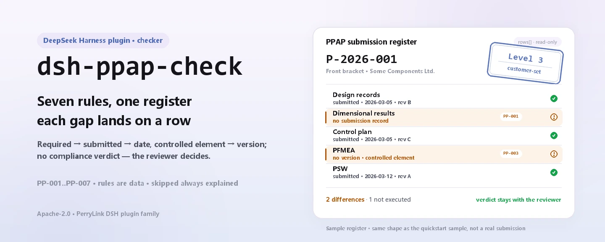

<div align="center">

<picture>
  <source media="(prefers-color-scheme: dark)" srcset="docs/assets/dsh-ppap-check-hero-en-dark.webp">
  
</picture>

# dsh-ppap-check

**PPAP जमा-तत्व सूची की पूर्णता और आंतरिक संगति की जाँच करता है — आपको मिलती है «कौन-सी पंक्ति, कौन-सा कॉलम, क्या कमी है» की सूची; निर्णय समीक्षक के पास रहता है।**

DeepSeek Harness के लिए एक डेटा-ओनली जाँच प्लगइन: एक PPAP जमा-तत्व सूची पढ़ता है (पार्ट हेडर और हर तत्व की एक पंक्ति), साथ में आया संस्करणित नियम-पैक (PP-001..PP-007) लागू करता है, और सामग्री के भीतर उन्हीं अंतरों को सूचीबद्ध करता है जिन्हें वह इंगित कर सकता है — कभी कोई अनुपालन-निर्णय नहीं, कभी कोई उत्तरदायित्व-निर्धारण नहीं।

[इंस्टॉल](#तीन-चरणों-में-शुरुआत) · [कॉन्फ़िगरेशन](#कॉन्फ़िगरेशन) · [FAQ](#faq) · [简体中文](README.md) · [English](README.en.md) · [Español](README.es.md) · [Português](README.pt.md) · [हिन्दी](README.hi.md)

[](LICENSE)
[](#संगतता)
[](https://www.npmjs.com/package/dsh-ppap-check)
[](https://github.com/PerryLink/dsh-ppap-check/actions/workflows/ci.yml)
[](#संगतता)

[](https://github.com/PerryLink/dsh-ppap-check/stargazers)
[](https://www.npmjs.com/package/dsh-ppap-check)
[](https://dshfind.com/plugins/PerryLink/dsh-ppap-check?ref=badge)
[](https://securityscorecards.dev/viewer/?uri=github.com/PerryLink/dsh-ppap-check)
[](https://dsh.market/)
[](https://gitee.com/perrylink/dsh-ppap-check)

```sh
dsh plugin --profile <name> add dsh-ppap-check
```

</div>

<sub>सामुदायिक प्लगइन, DeepSeek से असंबद्ध। आधिकारिक रेपो: <https://github.com/PerryLink/dsh-ppap-check> (Gitee एक मिरर है)।</sub>

## यह क्या है

`dsh-ppap-check` एक PPAP जमा-तत्व सूची पढ़ता है — पार्ट हेडर और हर तत्व की एक पंक्ति — और यह जाँचता है कि उस सूची से यांत्रिक रूप से क्या अपेक्षा की जा सकती है: ग्राहक द्वारा माँगे गए तत्व का जमा-रिकॉर्ड मौजूद है, जमा किए गए तत्व की तिथि दर्ज है, नियंत्रित तत्व (डिज़ाइन रिकॉर्ड, FMEA, नियंत्रण योजना, प्रक्रिया प्रवाह, आयामी परिणाम, MSA) का संस्करण दर्ज है, सूची में पार्ट नंबर और प्रस्तुति स्तर लिखा है, तत्व क्रमांक अद्वितीय हैं, और तत्व कॉलम में टेम्पलेट का कोई प्लेसहोल्डर नहीं बचा है।

यह तय नहीं करता कि PPAP स्वीकृत हो सकता है, स्तर सही है, या किसी तत्व की विषय-वस्तु ग्राहक की अपेक्षा पूरी करती है — अंतर-सूची समीक्षक के पास जाती है।

- **किसके लिए है**: गुणवत्ता और आपूर्तिकर्ता इंजीनियर; कमांड लाइन की ज़रूरत नहीं — सामग्री चैट में सौंप दीजिए।
- **आप क्या देते हैं**: वह मूल सामग्री जिस पर जाँच चलती है (तालिका, सूची या दस्तावेज़); मूल कभी नहीं बदला जाता। Excel को पहले JSON/YAML में बदला जा सकता है, प्लेटफ़ॉर्म समर्थन करे तो चैट में ही।
- **आपको क्या मिलता है**: «कौन-सी पंक्ति, कौन-सा कॉलम, क्या कमी है, कैसे सुधारें» की सूची; जो जाँच चल नहीं पाई वह `skipped` में कारण सहित दर्ज होती है।

<picture>
  <source media="(prefers-color-scheme: dark)" srcset="docs/assets/dsh-ppap-check-flow-v5-dark.svg">
  
</picture>

## तीन चरणों में शुरुआत

1. **इंस्टॉल करें** (कोई एक चैनल चुनें):

   ```sh
   # git चैनल (नवीनतम main; git+https://github.com/PerryLink/dsh-ppap-check.git के समतुल्य)
   dsh plugin --profile <name> add github:PerryLink/dsh-ppap-check
   # npm चैनल (प्रकाशित संस्करण)
   dsh plugin --profile <name> add dsh-ppap-check
   # tarball चैनल: इस रेपो में pnpm pack करके, फिर
   dsh plugin --profile <name> add ./dsh-ppap-check-<version>.tgz
   ```

2. **न्यूनतम कॉन्फ़िग** (डिफ़ॉल्ट पर भी चलता है; बिना `config` वाली bundle पंक्ति सभी डिफ़ॉल्ट लेती है और नियम-पैक का पथ साथ आए `rules/ppap-check.yaml` की ओर इशारा करता है):

   ```yaml
   - insert:
       - id: dsh-ppap-check
         name: dsh-ppap-check
   ```

3. **सत्यापित करें कि माउंट हुआ**:

   ```sh
   dsh --profile <name> --dump-config | grep 'dsh-ppap-check'
   ```

   फिर उसे एक सूची दीजिए — उदाहरण के लिए रेपो में आई नमूना सामग्री (अपेक्षित आउटपुट `samples/quickstart/expected/result.json` में):

   ```text
   > साथ आए नमूने पर यह जाँच चलाओ और बताओ कितने निष्कर्ष मिले और किस स्तर के।
   ppap_check: 1 issue(s) — error 0, warn 1, info 0
   skipped: 1
   ```

**अनइंस्टॉल**: `dsh plugin --profile <name> remove dsh-ppap-check` (या प्रोफ़ाइल पैच से वह पंक्ति हटा दें)।

<details>
<summary>WorkBuddy / Coze में उपयोग</summary>

WorkBuddy / Coze में «Professional Document Check Suite» खोजें (पूरा सेट; यह जाँच उसका एक हिस्सा है; उपलब्धता स्टोर सूची के अनुसार) — वही जाँच क्षमता बिना कमांड लाइन के मिल जाती है।

</details>

<details>
<summary>DSH Desktop मार्केट से इंस्टॉल करें</summary>

सभी PerryLink प्लगइन DSH Desktop के अंतर्निहित मार्केट में ब्राउज़ किए जा सकते हैं: **मार्केट → स्रोत → स्रोत जोड़ें → यह पेस्ट करें** `https://perrylink-dsh-catalog.perrylink.workers.dev/catalog-source.json` **→ चुनें**। इंस्टॉल के लिए मार्केट की npm पहचान जाँच और आपकी पुष्टि आवश्यक रहती है।

</details>

## मुख्य क्षमताएँ

`dsh-ppap-check` उपकरण `ppap_check` पंजीकृत करता है: एक जमा-तत्व सूची पढ़ता है, संस्करणित नियम-पैक लागू करता है और एक रिपोर्ट लौटाता है।

- **एक डेटा पैक में सात नियम** — नियम-पैक कोड नहीं, डेटा है (`rules/ppap-check.yaml`); उसे बदलने से पूरा नियम-सेट बदल जाता है, TypeScript की एक भी पंक्ति छुए बिना।
- **सामग्री पर केवल-पठन** — JSON या YAML स्वीकार करता है और मूल कभी नहीं बदलता; शुद्ध ESM, कोई नेटवर्क अनुरोध नहीं, कोई मॉडल कॉल नहीं।
- **कोई गढ़ा हुआ उद्धरण नहीं** — हर नियम में `document` / `number` / `clause` / `excerpt` / `kind` / `source` होता है; `excerpt` शब्दशः उद्धरण होना चाहिए, और जिन नियमों का खंड-पाठ इस बार नहीं मिला वे स्वयं `excerpt` में यह कहते हैं और `derived-from-principle` ही रहते हैं।
- **गंभीरता साक्ष्य के अनुसार** — `derived-from-principle` की अधिकतम सीमा `warn`, संस्थागत कॉन्फ़िगरेशन (`institutional-configuration`) की `info`; एक टेस्ट इसे लागू करता है।
- **खाली सूची कभी «सब ठीक» नहीं** — जो जाँच नहीं चल पाई वह कारण सहित `skipped` में दर्ज होती है; अपेक्षित सूची सेट न होने वाला नियम चुपचाप पास होने के बजाय स्वयं को `skipped` में बताता है।
- **निर्णय करने वाली भाषा नहीं** — रिपोर्ट केवल अंतर सूचीबद्ध करती है; अनुपालन, उत्तरदायित्व या शुद्धता पर कभी टिप्पणी नहीं। वर्डिंग गार्ड इसे लागू करता है और हर रिपोर्ट में अस्वीकरण रहता है।

| नियम | जाँच | गंभीरता | आधार प्रकार |
|---|---|---|---|
| `PP-001` | माँगे गए तत्व का जमा-रिकॉर्ड है | warn | principle |
| `PP-002` | जमा किए गए तत्व की तिथि दर्ज है | warn | principle |
| `PP-003` | नियंत्रित तत्व का संस्करण दर्ज है | warn | principle |
| `PP-004` | सूची में पार्ट नंबर और स्तर लिखा है | warn | principle |
| `PP-005` | स्तर आपके ग्राहक की शब्दावली से है (डिफ़ॉल्ट रूप से बंद) | info | local |
| `PP-006` | तत्व कॉलम में कोई बिना बदला प्लेसहोल्डर नहीं | warn | principle |
| `PP-007` | तत्व क्रमांक अद्वितीय हैं | warn | principle |

### उदाहरण

ये प्लगइन के वास्तविक प्रवेश-बिंदु हैं; एक बार इंस्टॉल करें, फिर कोई एक चलाएँ। नीचे की तालिका की पहली पंक्ति विस्तृत केस है, बाकी संक्षिप्त केस हैं।

**विस्तृत उदाहरण** — उपकरण `ppap_check`, इनपुट:

```json
{"partNo":"P-2026-001","partName":"前支架","rows":[{"序号":"1","提交要素":"设计记录","是否要求":"是","是否提交":"是"},{"序号":"2","提交要素":"尺寸结果","是否要求":"是","是否提交":""}]}
```

आउटपुट:

```json
{
  "id": "dsh-ppap-check.PP-001.de02f9e1",
  "ruleId": "PP-001",
  "severity": "warn",
  "locator": {
    "row": 2,
    "field": "required"
  },
  "found": "第 2 行「required」为「是」，但缺 submitted",
  "expected": "满足该条件的行应同时填写 submitted",
  "fix": "补提交或说明未提交原因；本条只核对清单闭环，不判断要素内容是否合格"
}
```

*स्रोत `dsh-ppap-check/tests/fixtures/PP-001/PP-001-unsafe.json (cases.json expects 1×PP-001); executed parseMaterial+runCheck, checkedAt=2026-10-06T00:00:00.000Z`*

| आपका सवाल | इसका जवाब |
|---|---|
| `required` कॉलम में तत्व माँगा गया है, पर उसका कोई जमा-रिकॉर्ड नहीं — क्या यह पकड़ में आता है? | हाँ। `PP-001` तब उस पंक्ति को दर्ज करता है जब `required` कॉलम में «माँगा गया» मानने वाला मान हो (`Y`, `yes`, `true`, `√`, या `conditionValues` में कॉन्फ़िगर की गई स्थानीय वर्तनी) और `submitted` कॉलम खाली हो। यह आपकी ही सूची का वह कॉलम पढ़ता है, कोई अंतर्निहित तत्व-सूची नहीं — कौन-से तत्व माँगे जाते हैं यह ग्राहक के बताए स्तर पर निर्भर है — और यह नहीं आँकता कि जमा की गई विषय-वस्तु स्वीकार्य है या नहीं। |
| पंक्ति जमा हुई दर्ज है, पर तिथि का सेल खाली है। और अगर तिथि भरी हो पर ग्राहक की समय-सीमा के बाद की हो? | `PP-002` तब पंक्ति दर्ज करता है जब `submitted` कॉलम में «जमा किया गया» मानने वाला मान हो (`Y`, `yes`, `true`, `√`, या कॉन्फ़िगर की गई स्थानीय वर्तनी) और `submittedAt` सेल खाली हो। यह केवल देखता है कि तिथि का सेल भरा है — यह नहीं कि तिथि ग्राहक की परियोजना योजना में तय समय-सीमा के भीतर है। |
| नियंत्रण योजना की पंक्ति में संस्करण सेल खाली है — क्या वह दर्ज होगी, और उन तत्वों का क्या जिनका संस्करण स्वभावतः नहीं होता? | `PP-003` केवल उन तत्व नामों को देखता है जो `conditionPattern` से मेल खाते हैं — डिज़ाइन रिकॉर्ड, इंजीनियरिंग परिवर्तन, DFMEA/PFMEA, नियंत्रण योजना, प्रक्रिया प्रवाह, आयामी परिणाम, मापन-प्रणाली विश्लेषण, नमूने, जाँच सहायक, PSW, सामग्री रिपोर्ट, प्रारंभिक प्रक्रिया क्षमता — और मेल खाने वाली हर पंक्ति दर्ज करता है जिसका `version` सेल खाली है। यह केवल देखता है कि संस्करण भरा है, यह नहीं कि वह सही या नवीनतम है; अगर किसी तत्व का संस्करण वास्तव में नहीं होता, तो पैटर्न संकीर्ण करें। |
| सभी तत्व पंक्तियाँ पूरी लगती हैं, पर उपकरण कहता है कि सूची में पार्ट नंबर और स्तर नहीं है। हमारा फ़ॉर्म स्तर हर पंक्ति में रखता है। | `PP-004` केवल हेडर पढ़ता है: `partNo` और `level` दोनों सामग्री के शीर्ष पर होने चाहिए। अगर आपका फ़ॉर्म स्तर विवरण पंक्तियों में रखता है, तो इस नियम के `fields` बदलें या अपनी अलग जाँच लिखें — यह नियम उन मानों को पंक्तियों में नहीं खोजता। |
| स्तर सेल में `Level 3` लिखा है, पर `PP-005` कुछ नहीं कहता। | `PP-005` खाली `values` सूची के साथ आता है, और खाली का अर्थ है बिना कॉन्फ़िगर, इसलिए वह चुपचाप पास होने के बजाय स्वयं को `skipped` में बताता है। अपने ग्राहक की स्तर-वर्तनियाँ `values` में डालें और सूची में न होने वाला कोई भी मान दर्ज होगा। फिर भी यह केवल देखता है कि मान आपकी सूची में है — चुना गया स्तर सही है या नहीं यह ग्राहक का निर्णय है — इसीलिए यह नियम `info` पर सीमित है। |
| हमारी सूची पिछले साल के टेम्पलेट से बनी है: एक तत्व नाम में अभी भी बिना बदला प्लेसहोल्डर है और दो पंक्तियों में एक ही तत्व क्रमांक है। | `PP-006` ऐसा तत्व नाम दर्ज करता है जिसमें अभी भी प्लेसहोल्डर है — कोष्ठक, ब्रेस, `XXX`, `xxx`, `TBD`, `todo`, या `terms` सूची जिसे आप अपने टेम्पलेट के अनुसार बदल सकते हैं। `PP-007` `elementNo` में दोहराए गए तत्व क्रमांक को दर्ज करता है, तुलना में रिक्त स्थान छोड़कर; मेल का अर्थ आम तौर पर तत्व दो बार दर्ज हुआ या क्रमांक गलत लिखा गया, और इनमें से कौन-सा, यह व्यक्ति को ही तय करना होता है। |

## मानक जिनका पालन होता है

| दस्तावेज़ | संख्यांक | इन्हें उद्धृत करने वाले नियम |
|---|---|---|
| PPAP (Production Part Approval Process) Manual, AIAG (मानक चीनी शीर्षक `rules/evidence/` में दर्ज है) | AIAG PPAP (वर्तमान संस्करण और खंड संख्या इस बार सत्यापित नहीं) | PP-001, PP-002, PP-003, PP-004, PP-005, PP-006, PP-007 |

**सीमा:** यह प्लगइन एक **PPAP जमा-तत्व सूची** की उन बातों की जाँच करता है जिन्हें यांत्रिक रूप से जाँचा जा सकता है — ग्राहक द्वारा माँगे गए तत्व का जमा-रिकॉर्ड है, जमा किए गए तत्व की तिथि दर्ज है, नियंत्रित तत्व (डिज़ाइन रिकॉर्ड, FMEA, नियंत्रण योजना, प्रक्रिया प्रवाह, आयामी परिणाम, MSA) का संस्करण दर्ज है, सूची में पार्ट नंबर और प्रस्तुति स्तर लिखा है, तत्व क्रमांक अद्वितीय हैं, और कोई टेम्पलेट प्लेसहोल्डर नहीं बचा है। यह तय **नहीं** करता कि PPAP स्वीकृत हो सकता है, स्तर सही है, या किसी तत्व की विषय-वस्तु ग्राहक की अपेक्षा पूरी करती है। **प्रस्तुति स्तर ग्राहक तय करता है, और यह प्लगइन स्तर-से-तत्व का कोई मानचित्र साथ नहीं लाता।**

> ### ⚠️ रिपोर्ट के किसी उद्धरण पर भरोसा करने से पहले यह पढ़ें
>
> **इस प्लगइन के नियम-पैक में हर `excerpt` स्पष्ट रूप से कहता है कि खंड-पाठ इस बार प्राप्त नहीं हुआ।** यह विधि ऑटोमोटिव **AIAG PPAP Manual** (और IATF 16949 के अंतर्गत ग्राहक-विशिष्ट अपेक्षाओं) में है। सत्यापन चरण शब्दशः खंड-पाठ नहीं ला सका, इसलिए यह नियम-पैक किसी उद्धरण का भावार्थ नहीं लिखता, बल्कि `excerpt` फ़ील्ड में ही यह कमी बताता है और ईमानदार तर्क `note` में रखता है। इसलिए हर नियम `warn` या `info` है, और एक टेस्ट सुनिश्चित करता है कि कोई नियम ऐसे उद्धरण का दावा न करे जो उसके पास नहीं है। **पाठ मिल जाने पर दो काम अनिवार्य हैं: हर `excerpt` को वास्तविक खंड से बदलें, और `kind` को `direct` तक उठाएँ।**
>
> **कौन-से तत्व जमा करने हैं यह ग्राहक के बताए स्तर पर निर्भर है** (Level 1–5), इसलिए `PP-001` **सूची के अपने `required` कॉलम** को पढ़ता है, किसी अंतर्निहित सूची को नहीं; और `PP-005` की स्तर-शब्दावली **खाली** आती है — शब्दावली कॉन्फ़िगर न होने पर वह चुपचाप पास होने के बजाय स्वयं को `skipped` में बताता है।

## कॉन्फ़िगरेशन

सभी समायोज्य पैरामीटर `src/config.ts` के Schemastery `Config` फ़ील्ड हैं (cordis.yml से बदले जा सकते हैं); प्रति-नियम सीमाएँ `rules/` के नियम-पैक में हैं। id पर आधारित ओवरराइड पूरी पंक्ति बदल देता है — जो कुंजियाँ चाहिए वे सब दोहराएँ।

| कुंजी | प्रकार | डिफ़ॉल्ट | विवरण |
|---|---|---|---|
| `rulesFile` | string | `rules/ppap-check.yaml` | नियम-पैक का पथ, पैकेज रूट के सापेक्ष |
| `disabledRules` | string[] | `[]` | बंद करने वाले नियम id; प्रत्येक `skipped` में दिखता है |
| `onlyRules` | string[] | `[]` | केवल ये नियम चलाएँ; खाली होने पर सभी नियम चलते हैं |
| `skipNotes` | string | `""` | हर `skipped` कारण के आगे जोड़ी जाने वाली टिप्पणी |
| `timeoutMs` | number | `120000` | उपकरण का सहकारी समय-सीमा बजट |

जानने योग्य नियम-स्तरीय पैरामीटर:

- `PP-001` `conditionValues` — आपके `required` कॉलम के वे मान जिनका अर्थ «माँगा गया» है; डिफ़ॉल्ट में `Y`, `yes`, `true`, `√` और नियम-पैक में दी गई चीनी वर्तनियाँ हैं।
- `PP-002` `conditionValues` — आपके `submitted` कॉलम के वे मान जिनका अर्थ «जमा किया गया» है।
- `PP-003` `conditionPattern` — वे तत्व नाम जिनका संस्करण होता है; डिफ़ॉल्ट डिज़ाइन रिकॉर्ड, इंजीनियरिंग परिवर्तन, DFMEA/PFMEA, नियंत्रण योजनाएँ, प्रक्रिया प्रवाह, आयामी परिणाम, MSA, नमूने, जाँच सहायक, PSW, सामग्री रिपोर्ट और प्रारंभिक क्षमता अध्ययनों को कवर करता है।
- `PP-005` `values` — आपके ग्राहक की स्तर-वर्तनियाँ, उदाहरण `[Level 1, Level 2, Level 3, Level 4, Level 5]`। खाली होने पर कोई जाँच नहीं।

आपके प्रोफ़ाइल पैच में ओवरराइड उदाहरण:

```yaml
- insert:
    - id: dsh-ppap-check
      name: dsh-ppap-check
      config:
        disabledRules: [PP-005]
        timeoutMs: 180000
```

## सामग्री प्रारूप

उपकरण JSON या YAML स्वीकार करता है:

```yaml
partNo: P-2026-001
partName: 前支架
supplier: 某某零部件有限公司
level: Level 3
rows:
  - { 序号: '1', 提交要素: 设计记录, 是否要求: 是, 是否提交: 是,
      提交日期: 2026-03-05, 版本: B, 责任人: 张工 }
```

कॉलम नामों की तुलना बड़े-छोटे अक्षरों की परवाह किए बिना, और रिक्त स्थान, अंडरस्कोर व हाइफन छोड़कर होती है; सूची के अपने कॉलम नाम बने रहते हैं, इसलिए निष्कर्ष उसी कॉलम का नाम बताता है जिसे पढ़ा गया। पढ़ने की परत में फ़ील्ड वैकल्पिक हैं और जाँच इंजन उन्हें सत्यापित करता है, इसलिए आंशिक निर्यात पर क्रैश के बजाय «अनुपस्थित मद» निष्कर्ष मिलते हैं।

## नियमों के स्रोत

नियम-डेटा `rules/ppap-check.yaml` में रहता है, कोड से अलग: प्रत्येक नियम में दस्तावेज़, संख्या, स्रोत की अपनी क्रमांकन-प्रणाली के अनुसार खंड संख्या, शब्दशः उद्धरण और स्रोत URL होता है। लोड-टाइम गार्ड सामान्यतः लागू करता है कि «उद्धरण कम से कम आठ अक्षरों का वास्तविक उद्धरण हो», पर वह उद्धरण और विवरण में अंतर नहीं कर सकता — इसलिए यह पैक हेडर, प्रति-नियम नोट, और एक ऐसे टेस्ट पर टिकता है जो दावा करता है कि हर `excerpt` उस कमी को स्वीकारता है। अपना आधार बढ़ा-चढ़ाकर बताने वाला पैक आत्मविश्वास भरी रिपोर्ट बनाने के बजाय लोड समय पर ही विफल होता है।

AIAG मैनुअल एक वाणिज्यिक प्रकाशन है जिसके सार्वजनिक माध्यमों में केवल कॉपीराइट सूचना और विषय-सूची है, पूरा पाठ नहीं; इसलिए `kind` का `derived-from-principle` पर बना रहना जान-बूझकर है, कोई अधूरा तकनीकी कर्ज़ नहीं। सत्यापन में पुष्टि हुई सीमाएँ और जान-बूझकर **न** निकाले गए निष्कर्ष साथ आए `rules/evidence/` डायरेक्टरी में हैं।

## FAQ

<details>
<summary>क्या यह हमारे लिए अनुपालन का फैसला करता है?</summary>

नहीं। यह केवल सामग्री के भीतर इंगित किए जा सकने वाले अंतर सूचीबद्ध करता है (कौन-सी पंक्ति, कौन-सा कॉलम, क्या कमी है, कैसे सुधारें) और तथ्य या अनुपालन पर फैसला नहीं करता — निष्कर्ष हमेशा समीक्षक के पास रहता है। वर्डिंग गार्ड रिपोर्ट की भाषा लागू करता है और हर रिपोर्ट में अस्वीकरण रहता है।

</details>

<details>
<summary>मेरी सूची Excel में है। क्या सीधे इस्तेमाल हो सकती है?</summary>

हाँ — पहले उसे JSON या YAML में बदलें; प्लेटफ़ॉर्म समर्थन करे तो चैट में ही रूपांतरण हो सकता है। उपकरण सामग्री केवल पढ़ता है और मूल कभी नहीं बदलता।

</details>

<details>
<summary>`PP-005` कभी कुछ क्यों नहीं बताता?</summary>

क्योंकि इस पैक के साथ कोई स्तर-शब्दावली नहीं आती: `values` डिफ़ॉल्ट रूप से खाली है, इसलिए नियम स्वयं को `skipped` में बताता है। `values` में अपने ग्राहक की स्तर-वर्तनियाँ भरने के बाद नियम यह देखने लगता है कि दर्ज स्तर उस सूची में है; फिर भी यह नहीं आँकता कि चुना गया स्तर सही है।

</details>

<details>
<summary>क्या खाली `issues` सूची को «कुछ गलत नहीं» पढ़ा जा सकता है?</summary>

नहीं। जो जाँच नहीं चल पाई वह कारण सहित `skipped` में दर्ज होती है (खाली स्तर-शब्दावली, अनुपस्थित कॉलम)। रिपोर्ट से कोई निष्कर्ष निकालने से पहले `issues` और `skipped` दोनों साथ पढ़ें।

</details>

<details>
<summary>क्या पूरी परियोजना की सूचियाँ एक साथ चलाने पर संभल पाएगा?</summary>

उपकरण `native` और `ptc` दोनों मोड में चलता है; बैच काम (पूरी परियोजना या पूरा फ़ोल्डर) के लिए `ptc` चुनें, जहाँ स्कीमा लागत एक ही बार लगती है। जाँच स्वयं स्थानीय कॉलम-मिलान और तिथि-तुलना है — कोई नेटवर्क अनुरोध नहीं, कोई मॉडल कॉल नहीं; `timeoutMs` (डिफ़ॉल्ट 120 सेकंड) सहकारी समय-सीमा बजट है।

</details>

<details>
<summary>क्या सामग्री अपलोड होती है या प्रशिक्षण में इस्तेमाल होती है?</summary>

नहीं। प्लगइन नेटवर्क का उपयोग नहीं करता, मॉडल कॉल नहीं करता, सामग्री केवल पढ़ता है और मूल में कभी वापस नहीं लिखता; रिपोर्ट स्थानीय रूप से बनती है।

</details>

## समस्या निवारण

- **`PP-005` कभी नहीं चलता।** उसकी स्तर-शब्दावली खाली है। स्तर-वर्तनियाँ हर ग्राहक में अलग होती हैं, प्लगइन उन्हें अनुमान से नहीं भरता।
- **`PP-001` उस तत्व पर चल पड़ा जिसे मैं जमा नहीं करना चाहता।** `required` कॉलम कहता है कि वह माँगा गया है। अगर आपके ग्राहक के स्तर पर वह तत्व नहीं माँगा जाता, तो पंक्ति हटाने के बजाय वह कॉलम सुधारें।
- **`PP-003` उस तत्व पर चल पड़ा जिसका संस्करण नहीं होता।** तत्व का नाम पैटर्न से मेल खाता है पर संस्करण कॉलम खाली है। अगर किसी तत्व का संस्करण वास्तव में नहीं होता, तो `conditionPattern` संकीर्ण करें।
- **प्लगइन इंस्टॉल हो गया पर टूल दिखता नहीं।** जाँचें कि `main` `lib/index.mjs` पर जाता है और `pnpm run build` ने उसे बनाया है; गलत `main` लोडर को उस प्रविष्टि को चुपचाप छोड़ने पर मजबूर कर देता है।
- **`dsh plugin add` असंगत बताकर मना करता है।** peer रेंज `0.1.x` और `0.2.x` दोनों को कवर करती है; रनटाइम उसके बाहर हो तो स्पष्ट छूट दें: `dsh plugin --profile <name> allow-version dsh-ppap-check@0.1.0 --dsh-version <runtime> --accept-risk`
- **`check` में `manifest-peers` विफल दिखता है।** स्टैटिक चेकर 0.2 लाइन से पहले की हार्ड-कोडेड peer रेंज से तुलना करता है। इंस्टॉल के समय अनुकूलता रनटाइम लागू करता है, इसलिए घोषित रेंज ही सही है; यह `dsh-plugin-dev` की ज्ञात अपस्ट्रीम समस्या है।
- **समय खिसका हुआ लगता है।** सारी गणना दिए गए स्ट्रिंग पर वॉल-क्लॉक है, कोई टाइमज़ोन रूपांतरण नहीं।

## संगतता

| सतह | स्थिति |
|---|---|
| Harness | peer रेंज `>=0.1.2-rc.1 <0.2.0 \|\| >=0.2.0-0 <0.3.0` — `0.2.0-rc.2` और `0.2.1-rc.2` दोनों को स्वीकार करने के लिए सत्यापित। `engines.dsh` `>=0.2.1-0 <0.3.0` के रूप में घोषित है और 0.2.1 से होस्ट इसे लागू करता है |
| Node | `^22.19.0 \|\| >=24.0.0` |
| प्लेटफ़ॉर्म | सभी (शुद्ध ESM; कोई नेटिव कोड नहीं, कोई नेटवर्क नहीं, कोई मॉडल कॉल नहीं) |
| टूल मोड | `native` और `ptc` में काम करता है; कई पार्ट्स के लिए `ptc` चुनें |

## इकोसिस्टम और गुणवत्ता

- [Gitee मिरर](https://gitee.com/perrylink/dsh-ppap-check) (सिंक मिरर; GitHub ही आधिकारिक है)
- [dshfind प्लगइन पेज](https://dshfind.com/plugins/PerryLink/dsh-ppap-check) (इंस्टॉल और रैंकिंग)
- [OpenSSF Scorecard रिपोर्ट](https://securityscorecards.dev/viewer/?uri=github.com/PerryLink/dsh-ppap-check) ([.github/workflows/scorecard.yml](.github/workflows/scorecard.yml) से संचालित)
- [DSH Market](https://dsh.market/) (सूचीबद्ध)
- **1024 स्टोर चैनल**: एक बार `npm i -g dsh1024`, फिर `dsh1024 plugin --profile <name> add dsh-ppap-check` ([deepseek1024.com](https://deepseek1024.com) इंस्टॉल रैंकिंग में गिना जाता है)
- [इकोसिस्टम नॉलेज बेस](https://perrylink.github.io/dsh-plugin-guide/) — प्लगइन विकास गाइड · चयन के मापे गए डेटा · रखरखाव मानदंड

## डेवलपमेंट

```sh
pnpm install                                        # node ^22.19 || >=24
pnpm run typecheck                                  # tsc --noEmit
pnpm test                                           # vitest: साझा टेबल-प्लगइन सूट + जुड़े फ़िक्स्चर
pnpm run build                                      # tsdown -> lib/index.mjs + lib/index.d.mts
pnpm run verify:self-contained                      # डिपेंडेंसी स्पेक रजिस्ट्री से हल होती हैं
pnpm run check:lockfile                             # lockfile ड्रिफ़्ट जाँच
pnpm run check:readmes                              # पाँचों भाषाओं के README की एकरूपता
pnpm run check:citations                            # नियम-पैक उद्धरण बेसलाइन
node ../scripts/sync-shared.mjs dsh-ppap-check      # ../_shared से src/shared ताज़ा करें
pnpm pack                                           # प्रकाशित tarball
```

यह प्लगइन **डेटा-ओनली** है: `src/model.ts` तालिका की आकृति घोषित करता है, साझा किट रीडर और जाँच इंजन देती है, और नियम-पैक हर जाँच घोषित करता है। स्थानीय नमूना रन (पहले `pnpm run build` से `lib/` बनाना ज़रूरी):

```sh
node samples/quickstart/run.mjs --json
# => {"tool":"ppap_check","issueCount":1,"summary":{"error":0,"warn":1,"info":0},"skippedCount":1}
```

नमूना इनपुट `samples/quickstart/input/` में, अपेक्षित आउटपुट `samples/quickstart/expected/result.json` में, और स्क्रीनशॉट `docs/assets/quickstart.png` में है। README की छवियाँ [`scripts/gen-readme-assets.py`](scripts/gen-readme-assets.py) से प्रोग्रामेटिक रूप में बनती हैं (hero के लिए Pillow, संरचना चित्र के लिए हाथ से लिखा SVG) और स्क्रिप्ट दोबारा चलाई जा सकती है; पुराना एकल-स्किन फ़्लो चित्र और डेमो छवियाँ बाहरी लिंक के लिए `docs/assets/` में बनी रहती हैं, जबकि README केवल नए चार hero रूपों और संरचना चित्र की हल्की/गहरी जोड़ी को संदर्भित करते हैं।

Topics: `deepseek-harness`, `dsh`, `dsh-plugin`, `cordis`, `ppap`

## परिवार और आभार

यह प्रोजेक्ट [PerryLink](https://github.com/PerryLink) के DeepSeek Harness प्लगइन परिवार का हिस्सा है (सभी Apache-2.0)। पूरा पारिवारिक सूचकांक: [सामग्री के अनुसार चेकर चुनें](https://perrylink.github.io/zh/checkers/choose/). यदि यह उपयोगी लगे, तो **एक स्टार अगले व्यक्ति को इसे खोजने में मदद करता है** — इसके पीछे कुछ भी बंद नहीं है।

- [@PerryLink](https://github.com/PerryLink) — निर्माता और रखरखावकर्ता: डेटा-ओनली नियम-पैक (PP-001..PP-007), `ppap_check` उपकरण, उद्धरण-सत्यापन अभिलेख और पाँच-भाषा दस्तावेज़।

<details>
<summary>सभी प्लगइन खोलें</summary>

| प्लगइन | स्थिति |
|---|---|
| **[dsh-ppap-check](https://github.com/PerryLink/dsh-ppap-check)** |  |
| **[dsh-aqua-input-check](https://github.com/PerryLink/dsh-aqua-input-check)** |  |
| **[dsh-archive-check](https://github.com/PerryLink/dsh-archive-check)** |  |
| **[dsh-auto-review](https://github.com/PerryLink/dsh-auto-review)** |  |
| **[dsh-autotier](https://github.com/PerryLink/dsh-autotier)** | 🧊 फ़्रोज़न — रेपो README देखें |
| **[dsh-bid-ca-precheck](https://github.com/PerryLink/dsh-bid-ca-precheck)** |  |
| **[dsh-bid-qual-check](https://github.com/PerryLink/dsh-bid-qual-check)** |  |
| **[dsh-cert-mcp](https://github.com/PerryLink/dsh-cert-mcp)** | 🧊 फ़्रोज़न — रेपो README देखें |
| **[dsh-checkpoint-rewind](https://github.com/PerryLink/dsh-checkpoint-rewind)** |  |
| **[dsh-click](https://github.com/PerryLink/dsh-click)** |  |
| **[dsh-composer-history](https://github.com/PerryLink/dsh-composer-history)** |  |
| **[dsh-contract-stance](https://github.com/PerryLink/dsh-contract-stance)** |  |
| **[dsh-customs-doc-check](https://github.com/PerryLink/dsh-customs-doc-check)** |  |
| **[dsh-data-quality](https://github.com/PerryLink/dsh-data-quality)** | 🧊 फ़्रोज़न — रेपो README देखें |
| **[dsh-demurrage-ledger](https://github.com/PerryLink/dsh-demurrage-ledger)** |  |
| **[dsh-doublecheck](https://github.com/PerryLink/dsh-doublecheck)** |  |
| **[dsh-drill-script-check](https://github.com/PerryLink/dsh-drill-script-check)** |  |
| **[dsh-eia-guide-check](https://github.com/PerryLink/dsh-eia-guide-check)** |  |
| **[dsh-emergency-plan](https://github.com/PerryLink/dsh-emergency-plan)** |  |
| **[dsh-essay-rubric-check](https://github.com/PerryLink/dsh-essay-rubric-check)** |  |
| **[dsh-evidence-check](https://github.com/PerryLink/dsh-evidence-check)** |  |
| **[dsh-export-ctl-check](https://github.com/PerryLink/dsh-export-ctl-check)** |  |
| **[dsh-fast](https://github.com/PerryLink/dsh-fast)** |  |
| **[dsh-fmea-table-check](https://github.com/PerryLink/dsh-fmea-table-check)** |  |
| **[dsh-forecast-penalty](https://github.com/PerryLink/dsh-forecast-penalty)** |  |
| **[dsh-fund-research](https://github.com/PerryLink/dsh-fund-research)** |  |
| **[dsh-github](https://github.com/PerryLink/dsh-github)** |  |
| **[dsh-gongwen-flow-check](https://github.com/PerryLink/dsh-gongwen-flow-check)** |  |
| **[dsh-gongwen-word-check](https://github.com/PerryLink/dsh-gongwen-word-check)** |  |
| **[dsh-guard-plan-qc](https://github.com/PerryLink/dsh-guard-plan-qc)** |  |
| **[dsh-hazchem-check](https://github.com/PerryLink/dsh-hazchem-check)** |  |
| **[dsh-hazplan-check](https://github.com/PerryLink/dsh-hazplan-check)** |  |
| **[dsh-hidden-risk-map](https://github.com/PerryLink/dsh-hidden-risk-map)** |  |
| **[dsh-hs-classify](https://github.com/PerryLink/dsh-hs-classify)** |  |
| **[dsh-icd-rule-check](https://github.com/PerryLink/dsh-icd-rule-check)** |  |
| **[dsh-industry-research](https://github.com/PerryLink/dsh-industry-research)** |  |
| **[dsh-lawcite-adapter](https://github.com/PerryLink/dsh-lawcite-adapter)** |  |
| **[dsh-laya](https://github.com/PerryLink/dsh-laya)** |  |
| **[dsh-lc-doc-check](https://github.com/PerryLink/dsh-lc-doc-check)** |  |
| **[dsh-learning-gap-check](https://github.com/PerryLink/dsh-learning-gap-check)** |  |
| **[dsh-library](https://github.com/PerryLink/dsh-library)** |  |
| **[dsh-local-ai](https://github.com/PerryLink/dsh-local-ai)** |  |
| **[dsh-lsp-actions](https://github.com/PerryLink/dsh-lsp-actions)** |  |
| **[dsh-mask](https://github.com/PerryLink/dsh-mask)** |  |
| **[dsh-mcp-panel](https://github.com/PerryLink/dsh-mcp-panel)** |  |
| **[dsh-medrec-qc](https://github.com/PerryLink/dsh-medrec-qc)** |  |
| **[dsh-memento](https://github.com/PerryLink/dsh-memento)** | 🧊 फ़्रोज़न — रेपो README देखें |
| **[dsh-nsfc-form-check](https://github.com/PerryLink/dsh-nsfc-form-check)** |  |
| **[dsh-nurse-record-check](https://github.com/PerryLink/dsh-nurse-record-check)** |  |
| **[dsh-observe](https://github.com/PerryLink/dsh-observe)** |  |
| **[dsh-origin-rvc-check](https://github.com/PerryLink/dsh-origin-rvc-check)** |  |
| **[dsh-ota-review-check](https://github.com/PerryLink/dsh-ota-review-check)** |  |
| **[dsh-output-styles](https://github.com/PerryLink/dsh-output-styles)** |  |
| **[dsh-paper-doc-adapter](https://github.com/PerryLink/dsh-paper-doc-adapter)** |  |
| **[dsh-permission-rules](https://github.com/PerryLink/dsh-permission-rules)** |  |
| **[dsh-permit-report-check](https://github.com/PerryLink/dsh-permit-report-check)** |  |
| **[dsh-pipeline-check](https://github.com/PerryLink/dsh-pipeline-check)** |  |
| **[dsh-pleading-draft](https://github.com/PerryLink/dsh-pleading-draft)** |  |
| **[dsh-plugin-doctor](https://github.com/PerryLink/dsh-plugin-doctor)** | 🚫 रिटायर्ड (रेपो संग्रहीत) |
| **[dsh-plugin-guide](https://github.com/PerryLink/dsh-plugin-guide)** |  |
| **[dsh-plugin-kit](https://github.com/PerryLink/dsh-plugin-kit)** | 🚫 रिटायर्ड (रेपो संग्रहीत) |
| **[dsh-plugin-upgrade](https://github.com/PerryLink/dsh-plugin-upgrade)** | 🚫 रिटायर्ड (रेपो संग्रहीत) |
| **[dsh-policy-brief-draft](https://github.com/PerryLink/dsh-policy-brief-draft)** |  |
| **[dsh-power-loss-split](https://github.com/PerryLink/dsh-power-loss-split)** |  |
| **[dsh-power-ticket-check](https://github.com/PerryLink/dsh-power-ticket-check)** |  |
| **[dsh-protest-deadline](https://github.com/PerryLink/dsh-protest-deadline)** |  |
| **[dsh-railway-window](https://github.com/PerryLink/dsh-railway-window)** |  |
| **[dsh-repair-order-qc](https://github.com/PerryLink/dsh-repair-order-qc)** |  |
| **[dsh-research-report](https://github.com/PerryLink/dsh-research-report)** |  |
| **[dsh-review-reply-check](https://github.com/PerryLink/dsh-review-reply-check)** |  |
| **[dsh-rulefile-check](https://github.com/PerryLink/dsh-rulefile-check)** |  |
| **[dsh-safety-brief-check](https://github.com/PerryLink/dsh-safety-brief-check)** |  |
| **[dsh-score](https://github.com/PerryLink/dsh-score)** | 🧊 फ़्रोज़न — रेपो README देखें |
| **[dsh-session-sync](https://github.com/PerryLink/dsh-session-sync)** |  |
| **[dsh-site-log-check](https://github.com/PerryLink/dsh-site-log-check)** |  |
| **[dsh-skill-pack-security](https://github.com/PerryLink/dsh-skill-pack-security)** |  |
| **[dsh-soe-decision-check](https://github.com/PerryLink/dsh-soe-decision-check)** |  |
| **[dsh-soilwater-check](https://github.com/PerryLink/dsh-soilwater-check)** |  |
| **[dsh-sop-sync-check](https://github.com/PerryLink/dsh-sop-sync-check)** |  |
| **[dsh-spc-gbt-adapter](https://github.com/PerryLink/dsh-spc-gbt-adapter)** |  |
| **[dsh-talk](https://github.com/PerryLink/dsh-talk)** |  |
| **[dsh-tender-extract](https://github.com/PerryLink/dsh-tender-extract)** |  |
| **[dsh-tender-matrix](https://github.com/PerryLink/dsh-tender-matrix)** |  |
| **[dsh-test-drive](https://github.com/PerryLink/dsh-test-drive)** |  |
| **[dsh-ticktick](https://github.com/PerryLink/dsh-ticktick)** | 🚫 रिटायर्ड (रेपो संग्रहीत) |
| **[dsh-translate](https://github.com/PerryLink/dsh-translate)** |  |
| **[dsh-warranty-calc](https://github.com/PerryLink/dsh-warranty-calc)** |  |
| **[dsh-budget](https://github.com/PerryLink/dsh-budget)** | 🧊 फ़्रोज़न — रेपो README देखें |
| **[dsh-claude-move](https://github.com/PerryLink/dsh-claude-move)** | 🧊 फ़्रोज़न — रेपो README देखें |
| **[dsh-defend](https://github.com/PerryLink/dsh-defend)** | 🧊 फ़्रोज़न — रेपो README देखें |
| **[dsh-draw](https://github.com/PerryLink/dsh-draw)** | 🧊 फ़्रोज़न — रेपो README देखें |
| **[dsh-reach](https://github.com/PerryLink/dsh-reach)** | 🧊 फ़्रोज़न — रेपो README देखें |
| **[dsh-background-agents](https://github.com/PerryLink/dsh-background-agents)** | 🚫 रिटायर्ड (रेपो संग्रहीत) |
| **[dsh-session-pin](https://github.com/PerryLink/dsh-session-pin)** | 🚫 रिटायर्ड (रेपो संग्रहीत) |
| **[dsh-team-rooms](https://github.com/PerryLink/dsh-team-rooms)** | 🚫 रिटायर्ड (रेपो संग्रहीत) |

</details>

## लाइसेंस

[LICENSE](LICENSE) (Apache License 2.0) © 2026 dsh-ppap-check contributors

<p align="center"><sub>Apache-2.0 · सामुदायिक प्लगइन, DeepSeek से असंबद्ध।</sub></p>
