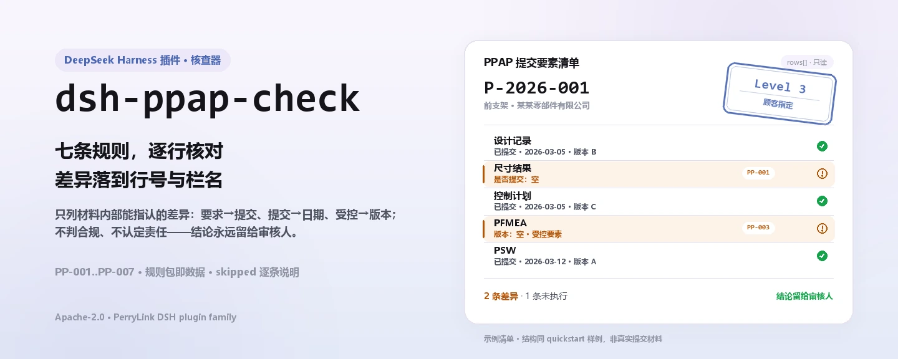
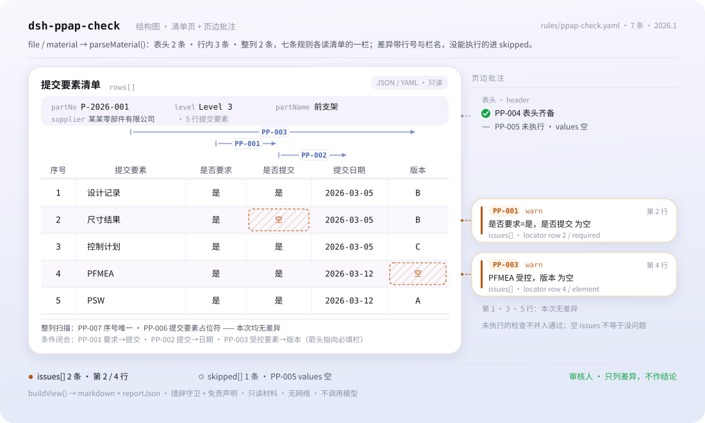

<div align="center">

<picture>
  <source media="(prefers-color-scheme: dark)" srcset="docs/assets/dsh-ppap-check-hero-zh-dark.webp">
  
</picture>

# dsh-ppap-check

**核对 PPAP 提交要素清单的齐备与自洽——输出「哪一行、哪一栏、差什么」的清单，结论留给审核人。**

面向 DeepSeek Harness 的数据型核查插件：读取一份 PPAP 提交要素清单（零件表头加每个要素一行），按随包的版本化规则包（PP-001..PP-007）逐条核对，只列材料内部能指认的差异，不判合规、不认定责任。

[安装](#三步上手) · [配置](#配置) · [FAQ](#faq) · [简体中文](README.md) · [English](README.en.md) · [Español](README.es.md) · [Português](README.pt.md) · [हिन्दी](README.hi.md)

[](LICENSE)
[](#兼容性)
[](https://www.npmjs.com/package/dsh-ppap-check)
[](https://github.com/PerryLink/dsh-ppap-check/actions/workflows/ci.yml)
[](#兼容性)

[](https://github.com/PerryLink/dsh-ppap-check/stargazers)
[](https://www.npmjs.com/package/dsh-ppap-check)
[](https://dshfind.com/plugins/PerryLink/dsh-ppap-check?ref=badge)
[](https://securityscorecards.dev/viewer/?uri=github.com/PerryLink/dsh-ppap-check)
[](https://dsh.market/)
[](https://gitee.com/perrylink/dsh-ppap-check)

```sh
dsh plugin --profile <name> add dsh-ppap-check
```

</div>

<sub>社区插件，与 DeepSeek 官方无关。唯一仓库：<https://github.com/PerryLink/dsh-ppap-check>（Gitee 为镜像）。</sub>

## 它是什么

`dsh-ppap-check` 读取一份 PPAP 提交要素清单——表头加每个要素一行——核对这份清单自身能被机械核对的部分：顾客要求的要素是否留下提交记录、已提交的要素是否填写提交日期、受控要素（设计记录、FMEA、控制计划、过程流程图、尺寸结果、测量系统分析）是否填写版本、清单是否写明零件号与提交等级、要素序号是否唯一、要素栏是否残留模板占位符。

它不判定 PPAP 是否可以批准、提交等级是否正确、要素内容是否满足顾客要求——差异清单交给审核人。

- **给谁用**：质量工程师、供应商管理；不用懂命令行，在对话里把材料交给它即可。
- **你交什么**：这项核对用到的原始材料（表格、清单或文书）；不改原件。Excel 可先转成 JSON/YAML，对话里也能代转。
- **它交什么**：一份「哪一行、哪一栏、差什么、怎么补」的清单；没能执行的检查逐条列入 `skipped` 并写明原因。

<picture>
  <source media="(prefers-color-scheme: dark)" srcset="docs/assets/dsh-ppap-check-flow-v5-dark.svg">
  
</picture>

## 三步上手

1. **安装**（三选一）：

   ```sh
   # git 通道（最新 main；等价于 git+https://github.com/PerryLink/dsh-ppap-check.git）
   dsh plugin --profile <name> add github:PerryLink/dsh-ppap-check
   # npm 通道（已发布版本）
   dsh plugin --profile <name> add dsh-ppap-check
   # tarball 通道：本仓库 pnpm pack 后
   dsh plugin --profile <name> add ./dsh-ppap-check-<version>.tgz
   ```

2. **最小配置**（默认即可用；bundle 行不带 `config` 时全部走默认值，规则包路径指向随包的 `rules/ppap-check.yaml`）：

   ```yaml
   - insert:
       - id: dsh-ppap-check
         name: dsh-ppap-check
   ```

3. **验证已生效**：

   ```sh
   dsh --profile <name> --dump-config | grep 'dsh-ppap-check'
   ```

   然后把一份清单交给它，例如用仓内自带样例（对应 `samples/quickstart/expected/result.json`）：

   ```text
   > 用自带样例跑一次这项检查，告诉我发现了几条问题、分别是什么级别。
   ppap_check: 1 issue(s) — error 0, warn 1, info 0
   skipped: 1
   ```

**卸载**：`dsh plugin --profile <name> remove dsh-ppap-check`（或从 profile patch 删掉该行）。

<details>
<summary>在 WorkBuddy / 扣子中使用</summary>

在 WorkBuddy / 扣子搜「职业文档核对全集」（总包，本检查是其中一项；上架以商城为准）即可调用同一套核对能力，无需命令行。

</details>

<details>
<summary>从 DSH Desktop 市场安装</summary>

所有 PerryLink 插件均可在 DSH Desktop 内置市场中浏览：**市场 → 来源 → 添加来源 → 粘贴** `https://perrylink-dsh-catalog.perrylink.workers.dev/catalog-source.json` **→ 选中**。安装仍需通过市场的 npm 身份校验与你的确认。

</details>

## 核心能力

`dsh-ppap-check` 注册 `ppap_check` 工具：读入一份提交要素清单，套用版本化规则包，返回一份报告。

- **七条规则一包带走** —— 规则包是数据不是代码（`rules/ppap-check.yaml`），换掉规则包即换掉整套检查，不动一行 TypeScript。
- **只读材料** —— 接受 JSON 或 YAML，原件永不修改；纯 ESM，无网络请求、不调用模型。
- **引文不造假** —— 每条规则带 `document` / `number` / `clause` / `excerpt` / `kind` / `source`；`excerpt` 必须是逐字引文，本次未取得原文的规则在 `excerpt` 里如实写明并标为 `derived-from-principle`。
- **严重级跟着证据走** —— `derived-from-principle` 最高 `warn`，本机构配置（`institutional-configuration`）最高 `info`，并有测试断言。
- **空清单 ≠ 没问题** —— 每条没能执行的检查都进 `skipped` 并写明原因；必填清单未配置的规则自我报告 `skipped`，绝不静默通过。
- **措辞不作裁决** —— 报告只列差异，不判定合规、责任或正确性；措辞守卫（wording guard）强制执行，报告永远附带免责声明。

| 规则 | 核对内容 | 严重级 | 依据类别 |
|---|---|---|---|
| `PP-001` | 顾客要求的要素已提交 | warn | principle |
| `PP-002` | 已提交的要素填写了提交日期 | warn | principle |
| `PP-003` | 受控要素填写了版本 | warn | principle |
| `PP-004` | 清单写明了零件号与提交等级 | warn | principle |
| `PP-005` | 提交等级取自顾客口径的取值（默认关闭） | info | local |
| `PP-006` | 要素栏没有残留的模板占位符 | warn | principle |
| `PP-007` | 要素序号唯一 | warn | principle |

### 示例

以下为插件真实入口；安装后调用一次即可。第一行是详细走查，其余是简短案例。

**详细示例** — 工具 `ppap_check`，输入：

```json
{"partNo":"P-2026-001","partName":"前支架","rows":[{"序号":"1","提交要素":"设计记录","是否要求":"是","是否提交":"是"},{"序号":"2","提交要素":"尺寸结果","是否要求":"是","是否提交":""}]}
```

输出：

```json
{
  "id": "dsh-ppap-check.PP-001.de02f9e1",
  "ruleId": "PP-001",
  "severity": "warn",
  "locator": {
    "row": 2,
    "field": "required"
  },
  "found": "第 2 行「required」为「是」，但缺 submitted",
  "expected": "满足该条件的行应同时填写 submitted",
  "fix": "补提交或说明未提交原因；本条只核对清单闭环，不判断要素内容是否合格"
}
```

*Observed from `dsh-ppap-check/tests/fixtures/PP-001/PP-001-unsafe.json (cases.json expects 1×PP-001); executed parseMaterial+runCheck, checkedAt=2026-10-06T00:00:00.000Z`*

| 你会问 | 它怎么答 |
|---|---|
| 「是否要求」栏标了要求，却没有提交记录，能查出来吗？ | 能。`PP-001` 在 `required` 栏取到表示「要求」的取值（`是`、`Y`、`yes`、`true`、`要求`、`√`）而 `submitted` 栏为空时逐行报出。它读的是你这张清单自己的那一栏，而不是任何内置要素清单——哪些要素属于要求提交取决于顾客指定的等级；它也不判断已提交的要素内容是否合格。 |
| 某行标了已提交，但提交日期栏空着；如果日期填了却晚于顾客的时限呢？ | `PP-002` 在 `submitted` 栏取到表示已提交的取值（`是`、`Y`、`yes`、`true`、`已提交`、`√`）而 `submittedAt` 栏为空时逐行报出。它只核对日期栏是否填写，不判断日期是否落在顾客项目计划规定的时限内。 |
| 控制计划这一行的版本栏空着，会被报出吗？那些本来就没有版本的要素呢？ | `PP-003` 只核对名称命中 `conditionPattern` 的要素——设计记录、工程更改、DFMEA／PFMEA、控制计划、过程流程图、尺寸结果、测量系统分析、样件、检查辅具、PSW、材料报告、初始过程能力——命中且 `version` 栏为空时逐条报出。它只核对版本栏是否填写，不判断版本是否正确、是否是最新版；若确有要素本来不需要版本，请收窄该模式。 |
| 每个要素行看着都齐了，工具却说清单没写零件号与等级。可我们的表式把等级记在每一行上。 | `PP-004` 只读表头：`partNo` 与 `level` 必须都在材料顶层。若本机构表式把等级记在明细行，请调整本条的 `fields` 或另建一条检查——本条不会到明细行里去找这两个值。 |
| 等级栏写的是 `Level 3`，可 `PP-005` 什么也不说。 | `PP-005` 的 `values` 清单出厂为空，空即未配置，因此本条在 `skipped` 里如实报告自己没能执行，而不是静默通过。把顾客口径的等级写法填进 `values`，清单里不在册的取值就会被报出。即便如此，它也只核对所填值是否在册——等级选得对不对是顾客的决定——这也是本条封顶 `info` 的原因。 |
| 我们的清单是照去年的模板抄的：一个要素名称还写着【待填】，两行又都编了同一个要素序号。 | `PP-006` 会报出仍含占位符的要素名称——`【`、`】`、`{{`、`}}`、`XXX`、`xxx`、`待填`、`待补充`、`TBD`、`todo`，这份 `terms` 清单可按本机构模板调整。`PP-007` 会报出 `elementNo` 中重复的要素序号，比较时忽略空白字符；命中通常意味着重复登记或序号抄错，究竟是哪一种需人工确认。 |

## 依据的标准

| 文件 | 文号 | 引用它的规则 |
|---|---|---|
| 《生产件批准程序（PPAP）手册》 | AIAG PPAP（现行版次与条号本次未核实） | PP-001, PP-002, PP-003, PP-004, PP-005, PP-006, PP-007 |

**边界：** 本插件核对一份 **PPAP 提交要素清单** 中可被机械核对的部分——顾客要求的要素是否留下提交记录，已提交的要素是否填写提交日期，受控要素（设计记录、FMEA、控制计划、过程流程图、尺寸结果、测量系统分析）是否填写版本，清单是否写明零件号与提交等级，要素序号是否唯一，以及是否残留模板占位符。它**不**判定 PPAP 是否可以批准、提交等级是否正确，或要素内容是否满足顾客要求。**提交等级由顾客设定，本插件不附带任何等级与要素的对应关系。**

> ### ⚠️ 在相信报告中的引文之前，请先读这一节
>
> **本插件规则库中的每一个 `excerpt` 都明文写着：条款原文本次未取得。** 该方法见于汽车行业的 **AIAG《生产件批准程序（PPAP）手册》**（以及 IATF 16949 下的顾客特殊要求）。核验环节无法取得逐字条款原文，因此本规则库不去转述一段引文，而是在 `excerpt` 字段本身写明这一缺口，并把诚实的推理放进 `note`。因此每条规则都是 `warn` 或 `info`，并且有一项测试断言没有任何规则声称拥有它并不拥有的引文。**待取得原文后，必须做两件事：把每个 `excerpt` 换成真实条款，并把 `kind` 提到 `direct`。**
>
> **哪些要素必须提交取决于顾客指定的等级**（Level 1–5），因此 `PP-001` 读的是**清单自己的「是否要求」栏**，而不是任何内置清单；`PP-005` 的等级词表出厂为**空**——未配置词表时，它会把自己记入 `skipped`，而不是静默通过。

## 配置

全部可调参数都在 `src/config.ts` 的 Schemastery schema 中，只改 `cordis.yml` 即可生效，无需改代码；逐条阈值在 `rules/` 下的规则库文件里。按 id 覆盖会替换整行——请重述所有需要的键。

| 键 | 类型 | 默认值 | 说明 |
|---|---|---|---|
| `rulesFile` | string | `rules/ppap-check.yaml` | 规则库文件路径，相对插件包根目录 |
| `disabledRules` | string[] | `[]` | 要停用的规则 id 列表；每条都会出现在 `skipped` 中 |
| `onlyRules` | string[] | `[]` | 只执行这些规则 id；留空表示执行全部规则 |
| `skipNotes` | string | `""` | 附加到每条 `skipped` 说明后的备注 |
| `timeoutMs` | number | `120000` | 工具协作式超时预算（毫秒） |

值得了解的规则级参数：

- `PP-001` `conditionValues` —— 你的「是否要求」栏里表示「要求」的取值，默认 `[是, Y, yes, true, 要求, √]`。
- `PP-002` `conditionValues` —— 你的「是否提交」栏里表示「已提交」的取值。
- `PP-003` `conditionPattern` —— 带版本要求的要素名称；默认覆盖设计记录、工程更改、DFMEA／PFMEA、控制计划、过程流程图、尺寸结果、测量系统分析、样件、检查辅具、PSW、材料报告与初始过程能力。
- `PP-005` `values` —— 顾客口径的等级写法，例如 `[Level 1, Level 2, Level 3, Level 4, Level 5]`。留空表示不核对。

profile patch 覆盖示例：

```yaml
- insert:
    - id: dsh-ppap-check
      name: dsh-ppap-check
      config:
        disabledRules: [PP-005]
        timeoutMs: 180000
```

## 材料格式

工具接受 JSON 或 YAML：

```yaml
partNo: P-2026-001
partName: 前支架
supplier: 某某零部件有限公司
level: Level 3
rows:
  - { 序号: '1', 提交要素: 设计记录, 是否要求: 是, 是否提交: 是,
      提交日期: 2026-03-05, 版本: B, 责任人: 张工 }
```

列名匹配忽略大小写，并忽略空格、下划线与连字符；清单自己的列名会被保留，因此发现里写明的列就是它实际读到的列。字段在读取层是可选的，由检查引擎校验，因此部分导出的材料会产生「缺项」类差异，而不是让程序崩溃。

## 规则来源

规则数据与代码分离，每条规则都带文件名、文号、按原文自身编号体系的条款号、逐字摘录与来源地址。加载期强制：摘录必须是真实引文且不少于八个字符；依据仅为原则性条款（`kind: derived-from-principle`，严重级上限 `warn`）或本机构配置（`kind: institutional-configuration`，上限 `info`）的检查不得标为 `error`。夸大依据的规则库会在加载期失败，而不会产出一份看起来很有底气的报告。

AIAG 手册是商业出版物，公开渠道只有版权声明与目录、没有正文，因此本规则包的 `kind` 长期保持 `derived-from-principle` 是设计如此，不是待办技术债。核验中确认的边界与「刻意没有作出的结论」见随包的 `rules/evidence/` 目录。

## FAQ

<details>
<summary>它会替我们下「合规 / 不合规」的结论吗？</summary>

不会。它只列出材料内部能逐条指认的差异（哪一行、哪一栏、差什么、怎么补），不下事实判断，也不评价合规性——结论永远留给审核人。报告措辞由 wording guard 强制约束，且每份报告都带免责声明。

</details>

<details>
<summary>我的清单是 Excel，能直接用吗？</summary>

可以，先转成 JSON 或 YAML；平台支持时在对话里就能代为转换。工具只读材料，永不修改原件。

</details>

<details>
<summary>为什么 `PP-005` 从来不报？</summary>

因为本规则库不带任何等级词表：`values` 出厂为空，规则自我报告 `skipped`。在配置里填入你顾客口径的等级写法后才生效——生效后它只核对所填等级是否在册，不判断该等级选择是否正确。

</details>

<details>
<summary>`issues` 为空能当作「没问题」吗？</summary>

不能。每条没能执行的检查都列在 `skipped` 里并写明原因（例如等级词表为空、清单缺列）。判读报告时请把 `issues` 与 `skipped` 一起看完。

</details>

<details>
<summary>一整个项目的清单一起查，性能吃得消吗？</summary>

工具在 `native` 与 `ptc` 两种模式都能跑；批量校验（例如整个项目或整个目录）建议 `ptc`，schema 成本只付一次。检查本身是纯本地的列匹配与日期比对，无网络请求、不调用模型；`timeoutMs`（默认 120 秒）是协作式超时预算。

</details>

<details>
<summary>材料会发到网上或用于训练吗？</summary>

不会。插件不联网、不调用模型、只读材料，也不写回原件；报告只在本机生成。

</details>

## 排障

- **`PP-005` 从不执行。** 它的等级词表为空。等级写法因顾客而异，插件不会替你猜。
- **`PP-001` 命中了我并不打算提交的要素。** 「是否要求」栏说它是要求的。若该要素在本顾客等级下确实不要求，请改正该栏，而不是删掉整行。
- **`PP-003` 命中了本来没有版本的要素。** 要素名称命中了模式而版本栏为空。若确有要素本来不需要版本，请收窄 `conditionPattern`。
- **插件装上了但工具不出现。** 确认 `main` 指向 `lib/index.mjs` 且 `pnpm run build` 已生成该文件；`main` 写错会让加载器静默跳过该条目。
- **`dsh plugin add` 报版本不兼容。** peer 范围覆盖 `0.1.x` 与 `0.2.x`；若运行时在其之外，可显式豁免：`dsh plugin --profile <name> allow-version dsh-ppap-check@0.1.0 --dsh-version <runtime> --accept-risk`
- **`check` 报 `manifest-peers` 失败。** 静态检查器比对的是一份早于 0.2 世代的硬编码 peer 范围；安装期的 peer 校验以运行时为准。这是 `dsh-plugin-dev` 的已知上游问题。
- **时间看起来偏移。** 全部计算都是对输入字符串做墙上时钟运算，不做时区换算。

## 兼容性

| 项目 | 状态 |
|---|---|
| Harness | 对等版本范围 `>=0.1.2-rc.1 <0.2.0 \|\| >=0.2.0-0 <0.3.0` —— 已实测同时接受 `0.2.0-rc.2` 与 `0.2.1-rc.2`。已声明 `engines.dsh`：0.2.1 起由宿主单独裁决，范围为 `>=0.2.1-0 <0.3.0` |
| Node | `^22.19.0 \|\| >=24.0.0` |
| 平台 | 全平台（纯 ESM；无原生代码、无联网、不调用模型） |
| 工具模式 | `native` / `ptc` 均可；批量校验整个目录时建议 `ptc`，schema 成本只付一次 |

## 生态与质量

- [Gitee 镜像](https://gitee.com/perrylink/dsh-ppap-check)（同步镜像，以 GitHub 为准）
- [dshfind 插件页](https://dshfind.com/plugins/PerryLink/dsh-ppap-check)（安装量与排名）
- [OpenSSF Scorecard 报告](https://securityscorecards.dev/viewer/?uri=github.com/PerryLink/dsh-ppap-check)（由 [.github/workflows/scorecard.yml](.github/workflows/scorecard.yml) 驱动）
- [DSH Market](https://dsh.market/)（已上架）
- **1024 商店渠道**：先 `npm i -g dsh1024`，再 `dsh1024 plugin --profile <name> add dsh-ppap-check`（计入 [deepseek1024.com](https://deepseek1024.com) 安装排行）
- [生态实测知识库](https://perrylink.github.io/dsh-plugin-guide/)：插件开发指南 · 选型实测数据 · 维护取舍判据

## 开发

```sh
pnpm install                                        # node ^22.19 || >=24
pnpm run typecheck                                  # tsc --noEmit
pnpm test                                           # vitest：共享表格插件套件 + 成对夹具
pnpm run build                                      # tsdown -> lib/index.mjs + lib/index.d.mts
pnpm run verify:self-contained                      # 依赖 spec 均来自 registry
pnpm run check:lockfile                             # lockfile 漂移检查
pnpm run check:readmes                              # 五语 README 一致性
pnpm run check:citations                            # 规则包引文基线
node ../scripts/sync-shared.mjs dsh-ppap-check      # 从 ../_shared 刷新 src/shared
pnpm pack                                           # 发布 tarball
```

本插件是**数据型**的：`src/model.ts` 声明表格结构，共享套件提供读取器与检查引擎，规则包声明每一条检查。本地样例试跑（需先 `pnpm run build` 产出 `lib/`）：

```sh
node samples/quickstart/run.mjs --json
# => {"tool":"ppap_check","issueCount":1,"summary":{"error":0,"warn":1,"info":0},"skippedCount":1}
```

样例输入在 `samples/quickstart/input/`，期望输出在 `samples/quickstart/expected/result.json`，截图见 `docs/assets/quickstart.png`。README 配图由 [`scripts/gen-readme-assets.py`](scripts/gen-readme-assets.py) 程序化生成（Pillow 画 hero、手写 SVG 画结构图），可重复执行；旧的单版流程图与演示图保留在 `docs/assets/` 供外链使用，README 只引用新生成的 hero 四版与结构图双版。

Topics：`deepseek-harness`, `dsh`, `dsh-plugin`, `cordis`, `ppap`

## 家族与致谢

本项目是 [PerryLink](https://github.com/PerryLink) 维护的 DeepSeek Harness 插件家族成员（全部 Apache-2.0）。完整家族索引见[按材料选核查器](https://perrylink.github.io/zh/checkers/choose/)。如果这个插件帮到了你，**给个 star**——它不解锁任何功能，但会让下一个人更容易找到它。

- [@PerryLink](https://github.com/PerryLink) —— 创建者与维护者：数据型规则包（PP-001..PP-007）、`ppap_check` 工具、引文核验记录与五语文档。

<details>
<summary>展开全部插件</summary>

| 插件 | 状态 |
|---|---|
| **[dsh-ppap-check](https://github.com/PerryLink/dsh-ppap-check)** |  |
| **[dsh-aqua-input-check](https://github.com/PerryLink/dsh-aqua-input-check)** |  |
| **[dsh-archive-check](https://github.com/PerryLink/dsh-archive-check)** |  |
| **[dsh-auto-review](https://github.com/PerryLink/dsh-auto-review)** |  |
| **[dsh-autotier](https://github.com/PerryLink/dsh-autotier)** | 🧊 已冻结 — 见仓库 README |
| **[dsh-bid-ca-precheck](https://github.com/PerryLink/dsh-bid-ca-precheck)** |  |
| **[dsh-bid-qual-check](https://github.com/PerryLink/dsh-bid-qual-check)** |  |
| **[dsh-cert-mcp](https://github.com/PerryLink/dsh-cert-mcp)** | 🧊 已冻结 — 见仓库 README |
| **[dsh-checkpoint-rewind](https://github.com/PerryLink/dsh-checkpoint-rewind)** |  |
| **[dsh-click](https://github.com/PerryLink/dsh-click)** |  |
| **[dsh-composer-history](https://github.com/PerryLink/dsh-composer-history)** |  |
| **[dsh-contract-stance](https://github.com/PerryLink/dsh-contract-stance)** |  |
| **[dsh-customs-doc-check](https://github.com/PerryLink/dsh-customs-doc-check)** |  |
| **[dsh-data-quality](https://github.com/PerryLink/dsh-data-quality)** | 🧊 已冻结 — 见仓库 README |
| **[dsh-demurrage-ledger](https://github.com/PerryLink/dsh-demurrage-ledger)** |  |
| **[dsh-doublecheck](https://github.com/PerryLink/dsh-doublecheck)** |  |
| **[dsh-drill-script-check](https://github.com/PerryLink/dsh-drill-script-check)** |  |
| **[dsh-eia-guide-check](https://github.com/PerryLink/dsh-eia-guide-check)** |  |
| **[dsh-emergency-plan](https://github.com/PerryLink/dsh-emergency-plan)** |  |
| **[dsh-essay-rubric-check](https://github.com/PerryLink/dsh-essay-rubric-check)** |  |
| **[dsh-evidence-check](https://github.com/PerryLink/dsh-evidence-check)** |  |
| **[dsh-export-ctl-check](https://github.com/PerryLink/dsh-export-ctl-check)** |  |
| **[dsh-fast](https://github.com/PerryLink/dsh-fast)** |  |
| **[dsh-fmea-table-check](https://github.com/PerryLink/dsh-fmea-table-check)** |  |
| **[dsh-forecast-penalty](https://github.com/PerryLink/dsh-forecast-penalty)** |  |
| **[dsh-fund-research](https://github.com/PerryLink/dsh-fund-research)** |  |
| **[dsh-github](https://github.com/PerryLink/dsh-github)** |  |
| **[dsh-gongwen-flow-check](https://github.com/PerryLink/dsh-gongwen-flow-check)** |  |
| **[dsh-gongwen-word-check](https://github.com/PerryLink/dsh-gongwen-word-check)** |  |
| **[dsh-guard-plan-qc](https://github.com/PerryLink/dsh-guard-plan-qc)** |  |
| **[dsh-hazchem-check](https://github.com/PerryLink/dsh-hazchem-check)** |  |
| **[dsh-hazplan-check](https://github.com/PerryLink/dsh-hazplan-check)** |  |
| **[dsh-hidden-risk-map](https://github.com/PerryLink/dsh-hidden-risk-map)** |  |
| **[dsh-hs-classify](https://github.com/PerryLink/dsh-hs-classify)** |  |
| **[dsh-icd-rule-check](https://github.com/PerryLink/dsh-icd-rule-check)** |  |
| **[dsh-industry-research](https://github.com/PerryLink/dsh-industry-research)** |  |
| **[dsh-lawcite-adapter](https://github.com/PerryLink/dsh-lawcite-adapter)** |  |
| **[dsh-laya](https://github.com/PerryLink/dsh-laya)** |  |
| **[dsh-lc-doc-check](https://github.com/PerryLink/dsh-lc-doc-check)** |  |
| **[dsh-learning-gap-check](https://github.com/PerryLink/dsh-learning-gap-check)** |  |
| **[dsh-library](https://github.com/PerryLink/dsh-library)** |  |
| **[dsh-local-ai](https://github.com/PerryLink/dsh-local-ai)** |  |
| **[dsh-lsp-actions](https://github.com/PerryLink/dsh-lsp-actions)** |  |
| **[dsh-mask](https://github.com/PerryLink/dsh-mask)** |  |
| **[dsh-mcp-panel](https://github.com/PerryLink/dsh-mcp-panel)** |  |
| **[dsh-medrec-qc](https://github.com/PerryLink/dsh-medrec-qc)** |  |
| **[dsh-memento](https://github.com/PerryLink/dsh-memento)** | 🧊 已冻结 — 见仓库 README |
| **[dsh-nsfc-form-check](https://github.com/PerryLink/dsh-nsfc-form-check)** |  |
| **[dsh-nurse-record-check](https://github.com/PerryLink/dsh-nurse-record-check)** |  |
| **[dsh-observe](https://github.com/PerryLink/dsh-observe)** |  |
| **[dsh-origin-rvc-check](https://github.com/PerryLink/dsh-origin-rvc-check)** |  |
| **[dsh-ota-review-check](https://github.com/PerryLink/dsh-ota-review-check)** |  |
| **[dsh-output-styles](https://github.com/PerryLink/dsh-output-styles)** |  |
| **[dsh-paper-doc-adapter](https://github.com/PerryLink/dsh-paper-doc-adapter)** |  |
| **[dsh-permission-rules](https://github.com/PerryLink/dsh-permission-rules)** |  |
| **[dsh-permit-report-check](https://github.com/PerryLink/dsh-permit-report-check)** |  |
| **[dsh-pipeline-check](https://github.com/PerryLink/dsh-pipeline-check)** |  |
| **[dsh-pleading-draft](https://github.com/PerryLink/dsh-pleading-draft)** |  |
| **[dsh-plugin-doctor](https://github.com/PerryLink/dsh-plugin-doctor)** | 🚫 已退役（仓库已归档） |
| **[dsh-plugin-guide](https://github.com/PerryLink/dsh-plugin-guide)** |  |
| **[dsh-plugin-kit](https://github.com/PerryLink/dsh-plugin-kit)** | 🚫 已退役（仓库已归档） |
| **[dsh-plugin-upgrade](https://github.com/PerryLink/dsh-plugin-upgrade)** | 🚫 已退役（仓库已归档） |
| **[dsh-policy-brief-draft](https://github.com/PerryLink/dsh-policy-brief-draft)** |  |
| **[dsh-power-loss-split](https://github.com/PerryLink/dsh-power-loss-split)** |  |
| **[dsh-power-ticket-check](https://github.com/PerryLink/dsh-power-ticket-check)** |  |
| **[dsh-protest-deadline](https://github.com/PerryLink/dsh-protest-deadline)** |  |
| **[dsh-railway-window](https://github.com/PerryLink/dsh-railway-window)** |  |
| **[dsh-repair-order-qc](https://github.com/PerryLink/dsh-repair-order-qc)** |  |
| **[dsh-research-report](https://github.com/PerryLink/dsh-research-report)** |  |
| **[dsh-review-reply-check](https://github.com/PerryLink/dsh-review-reply-check)** |  |
| **[dsh-rulefile-check](https://github.com/PerryLink/dsh-rulefile-check)** |  |
| **[dsh-safety-brief-check](https://github.com/PerryLink/dsh-safety-brief-check)** |  |
| **[dsh-score](https://github.com/PerryLink/dsh-score)** | 🧊 已冻结 — 见仓库 README |
| **[dsh-session-sync](https://github.com/PerryLink/dsh-session-sync)** |  |
| **[dsh-site-log-check](https://github.com/PerryLink/dsh-site-log-check)** |  |
| **[dsh-skill-pack-security](https://github.com/PerryLink/dsh-skill-pack-security)** |  |
| **[dsh-soe-decision-check](https://github.com/PerryLink/dsh-soe-decision-check)** |  |
| **[dsh-soilwater-check](https://github.com/PerryLink/dsh-soilwater-check)** |  |
| **[dsh-sop-sync-check](https://github.com/PerryLink/dsh-sop-sync-check)** |  |
| **[dsh-spc-gbt-adapter](https://github.com/PerryLink/dsh-spc-gbt-adapter)** |  |
| **[dsh-talk](https://github.com/PerryLink/dsh-talk)** |  |
| **[dsh-tender-extract](https://github.com/PerryLink/dsh-tender-extract)** |  |
| **[dsh-tender-matrix](https://github.com/PerryLink/dsh-tender-matrix)** |  |
| **[dsh-test-drive](https://github.com/PerryLink/dsh-test-drive)** |  |
| **[dsh-ticktick](https://github.com/PerryLink/dsh-ticktick)** | 🚫 已退役（仓库已归档） |
| **[dsh-translate](https://github.com/PerryLink/dsh-translate)** |  |
| **[dsh-warranty-calc](https://github.com/PerryLink/dsh-warranty-calc)** |  |
| **[dsh-budget](https://github.com/PerryLink/dsh-budget)** | 🧊 已冻结 — 见仓库 README |
| **[dsh-claude-move](https://github.com/PerryLink/dsh-claude-move)** | 🧊 已冻结 — 见仓库 README |
| **[dsh-defend](https://github.com/PerryLink/dsh-defend)** | 🧊 已冻结 — 见仓库 README |
| **[dsh-draw](https://github.com/PerryLink/dsh-draw)** | 🧊 已冻结 — 见仓库 README |
| **[dsh-reach](https://github.com/PerryLink/dsh-reach)** | 🧊 已冻结 — 见仓库 README |
| **[dsh-background-agents](https://github.com/PerryLink/dsh-background-agents)** | 🚫 已退役（仓库已归档） |
| **[dsh-session-pin](https://github.com/PerryLink/dsh-session-pin)** | 🚫 已退役（仓库已归档） |
| **[dsh-team-rooms](https://github.com/PerryLink/dsh-team-rooms)** | 🚫 已退役（仓库已归档） |

</details>

## License

[LICENSE](LICENSE)（Apache License 2.0）© 2026 dsh-ppap-check contributors

<p align="center"><sub>Apache-2.0 · 社区插件，与 DeepSeek 无关。</sub></p>
