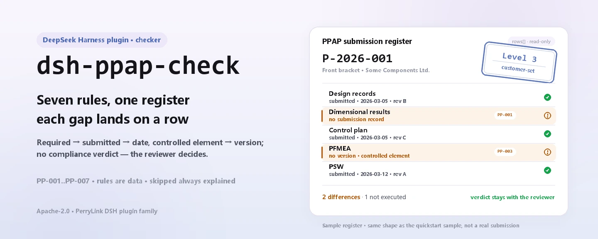

<div align="center">

<picture>
  <source media="(prefers-color-scheme: dark)" srcset="docs/assets/dsh-ppap-check-hero-en-dark.webp">
  
</picture>

# dsh-ppap-check

**Verifica a completude e a coerência interna de uma lista de elementos de submissão do PPAP — obtém uma lista de que linha, que coluna e o que falta; o veredito fica com o revisor.**

Um plugin verificador só de dados para o DeepSeek Harness: lê uma lista de elementos de submissão do PPAP (o cabeçalho da peça mais uma linha por elemento), aplica o pacote de regras versionado que traz consigo (PP-001..PP-007) e apenas lista as diferenças que consegue apontar dentro do material — nunca um veredito de conformidade, nunca uma atribuição de responsabilidade.

[Instalar](#instalação-em-três-passos) · [Configuração](#configuração) · [FAQ](#faq) · [简体中文](README.md) · [English](README.en.md) · [Español](README.es.md) · [Português](README.pt.md) · [हिन्दी](README.hi.md)

[](LICENSE)
[](#compatibilidade)
[](https://www.npmjs.com/package/dsh-ppap-check)
[](https://github.com/PerryLink/dsh-ppap-check/actions/workflows/ci.yml)
[](#compatibilidade)

[](https://github.com/PerryLink/dsh-ppap-check/stargazers)
[](https://www.npmjs.com/package/dsh-ppap-check)
[](https://dshfind.com/plugins/PerryLink/dsh-ppap-check?ref=badge)
[](https://securityscorecards.dev/viewer/?uri=github.com/PerryLink/dsh-ppap-check)
[](https://dsh.market/)
[](https://gitee.com/perrylink/dsh-ppap-check)

```sh
dsh plugin --profile <name> add dsh-ppap-check
```

</div>

<sub>Plugin da comunidade, sem afiliação com a DeepSeek. Repositório canónico: <https://github.com/PerryLink/dsh-ppap-check> (o Gitee é um espelho).</sub>

## O que é

`dsh-ppap-check` lê uma lista de elementos de submissão do PPAP —o cabeçalho da peça mais uma linha por elemento— e verifica o que a uma lista se pode exigir mecanicamente: que um elemento exigido pelo cliente tenha um registo de submissão, que um elemento submetido tenha data, que um elemento controlado (registo de projeto, FMEA, plano de controlo, fluxograma do processo, resultados dimensionais, MSA) tenha uma revisão, que a folha indique o número da peça e o nível de submissão, que os números de elemento sejam únicos e que não sobreviva nenhum marcador de modelo na coluna do elemento.

Não decide se o PPAP pode ser aprovado, se o nível está correto ou se o conteúdo de um elemento satisfaz o cliente: a lista de diferenças vai para o revisor.

- **Para quem é**: engenheiros de qualidade e de fornecedores; não é precisa linha de comandos, basta entregar o material na conversa.
- **O que você entrega**: o material de origem sobre o qual a verificação trabalha (uma tabela, uma lista ou um documento); o original nunca é modificado. Excel pode ser convertido antes para JSON/YAML, na própria conversa se a plataforma o permitir.
- **O que recebe de volta**: uma lista de «que linha, que coluna, o que falta, como corrigir»; cada verificação que não pôde ser executada aparece em `skipped` com o seu motivo.

<picture>
  <source media="(prefers-color-scheme: dark)" srcset="docs/assets/dsh-ppap-check-flow-v5-dark.svg">
  
</picture>

## Instalação em três passos

1. **Instale** (escolha um canal):

   ```sh
   # canal git (main mais recente; equivalente a git+https://github.com/PerryLink/dsh-ppap-check.git)
   dsh plugin --profile <name> add github:PerryLink/dsh-ppap-check
   # canal npm (versões publicadas)
   dsh plugin --profile <name> add dsh-ppap-check
   # canal tarball: pnpm pack neste repositório e depois
   dsh plugin --profile <name> add ./dsh-ppap-check-<version>.tgz
   ```

2. **Configuração mínima** (predefinições prontas; uma linha de bundle sem `config` aplica todas as predefinições e o caminho do pacote de regras aponta para o `rules/ppap-check.yaml` incluído):

   ```yaml
   - insert:
       - id: dsh-ppap-check
         name: dsh-ppap-check
   ```

3. **Verifique que monta**:

   ```sh
   dsh --profile <name> --dump-config | grep 'dsh-ppap-check'
   ```

   Depois entregue-lhe uma lista —por exemplo a amostra incluída no repositório (saída esperada em `samples/quickstart/expected/result.json`):

   ```text
   > Executa esta verificação com a amostra incluída e diz-me quantos achados há e de que nível.
   ppap_check: 1 issue(s) — error 0, warn 1, info 0
   skipped: 1
   ```

**Desinstalar**: `dsh plugin --profile <name> remove dsh-ppap-check` (ou remova a linha do patch do perfil).

<details>
<summary>Usar no WorkBuddy / Coze</summary>

Procure «Professional Document Check Suite» no WorkBuddy / Coze (o conjunto completo; esta verificação é uma parte; disponibilidade conforme a loja) para invocar a mesma capacidade de verificação sem linha de comandos.

</details>

<details>
<summary>Instalar a partir do mercado do DSH Desktop</summary>

Todos os plugins PerryLink podem ser explorados no mercado integrado do DSH Desktop: **Mercado → Fontes → Adicionar fonte → cole** `https://perrylink-dsh-catalog.perrylink.workers.dev/catalog-source.json` **→ selecione**. A instalação continua a exigir a verificação de identidade npm do mercado e a sua confirmação.

</details>

## Capacidades principais

`dsh-ppap-check` regista a ferramenta `ppap_check`: lê uma lista de elementos de submissão, aplica um pacote de regras versionado e devolve um relatório.

- **Sete regras num pacote de dados** — o pacote de regras é dados, não código (`rules/ppap-check.yaml`); substituí-lo troca todo o conjunto de regras sem tocar numa linha de TypeScript.
- **Apenas leitura sobre o material** — aceita JSON ou YAML e nunca modifica o original; ESM puro, sem pedidos de rede e sem chamadas ao modelo.
- **Sem citações inventadas** — cada regra traz `document` / `number` / `clause` / `excerpt` / `kind` / `source`; `excerpt` tem de ser uma citação literal, e as regras cujo texto da cláusula não foi obtido desta vez dizem-no no próprio `excerpt` e permanecem marcadas como `derived-from-principle`.
- **A severidade segue a evidência** — `derived-from-principle` tem teto `warn`, a configuração institucional (`institutional-configuration`) tem teto `info`, e um teste garante-o.
- **Uma lista vazia nunca é «está tudo bem»** — cada verificação que não pôde ser executada é reportada em `skipped` com o seu motivo; uma regra cuja lista obrigatória não está configurada reporta-se em `skipped` em vez de passar em silêncio.
- **Sem redação adjudicadora** — o relatório lista diferenças e nunca se pronuncia sobre conformidade, responsabilidade ou correção; um guardião de redação (wording guard) impõe isto e cada relatório traz a declaração de exoneração.

| Regra | Verificação | Severidade | Tipo de base |
|---|---|---|---|
| `PP-001` | um elemento exigido tem registo de submissão | warn | principle |
| `PP-002` | um elemento submetido tem data | warn | principle |
| `PP-003` | um elemento controlado tem revisão | warn | principle |
| `PP-004` | a folha indica número da peça e nível | warn | principle |
| `PP-005` | o nível vem do vocabulário do seu cliente (desativada por predefinição) | info | local |
| `PP-006` | a coluna do elemento não guarda marcadores por substituir | warn | principle |
| `PP-007` | os números de elemento são únicos | warn | principle |

### Exemplos

Estes são os pontos de entrada reais do plugin; instale uma vez e invoque um. A primeira linha da tabela abaixo é o percurso detalhado e as restantes são casos curtos.

**Exemplo detalhado** — ferramenta `ppap_check`, entrada:

```json
{"partNo":"P-2026-001","partName":"前支架","rows":[{"序号":"1","提交要素":"设计记录","是否要求":"是","是否提交":"是"},{"序号":"2","提交要素":"尺寸结果","是否要求":"是","是否提交":""}]}
```

Saída:

```json
{
  "id": "dsh-ppap-check.PP-001.de02f9e1",
  "ruleId": "PP-001",
  "severity": "warn",
  "locator": {
    "row": 2,
    "field": "required"
  },
  "found": "第 2 行「required」为「是」，但缺 submitted",
  "expected": "满足该条件的行应同时填写 submitted",
  "fix": "补提交或说明未提交原因；本条只核对清单闭环，不判断要素内容是否合格"
}
```

*Observado em `dsh-ppap-check/tests/fixtures/PP-001/PP-001-unsafe.json (cases.json expects 1×PP-001); executed parseMaterial+runCheck, checkedAt=2026-10-06T00:00:00.000Z`*

| Você pergunta | O que ele responde |
|---|---|
| Um elemento está marcado como exigido na coluna 是否要求, mas não há registo de submissão — isso é reportado? | Sim. `PP-001` assinala a linha quando a coluna `required` contém um valor que conta como exigido (`是`, `Y`, `yes`, `true`, `要求`, `√`) e a coluna `submitted` está vazia. Lê essa coluna da sua própria lista, nunca um catálogo de elementos incorporado — que elementos são exigidos depende do nível que o cliente indicar — e não julga se o conteúdo do que foi submetido é aceitável. |
| A linha consta como submetida, mas a célula da data está vazia. E se a data estiver preenchida mas cair depois do prazo do cliente? | `PP-002` assinala a linha cuja coluna `submitted` contém um valor que conta como submetido (`是`, `Y`, `yes`, `true`, `已提交`, `√`) e cuja célula `submittedAt` está em branco. Verifica apenas que a célula da data está preenchida: não verifica se a data cai dentro do prazo definido pelo plano de projeto do cliente. |
| A linha do plano de controlo está preenchida mas a célula da versão está vazia — é reportado? E os elementos que por natureza não têm versão? | `PP-003` olha para os nomes de elemento que correspondem a `conditionPattern` — registo de projeto, alteração de engenharia, DFMEA/PFMEA, plano de controlo, fluxograma do processo, resultados dimensionais, análise do sistema de medição, amostras, auxiliares de verificação, PSW, relatórios de material, capacidade inicial do processo — e reporta cada linha correspondente cuja célula `version` esteja vazia. Verifica apenas que a versão está preenchida, não que seja a correta ou a vigente; se um elemento realmente não tiver versão, restrinja o padrão. |
| Todas as linhas de elementos parecem completas, mas a ferramenta diz que falta o número da peça e o nível. No nosso formulário o nível fica em cada linha. | `PP-004` lê apenas o cabeçalho: `partNo` e `level` têm de estar ambos no topo do material. Se o seu formulário guarda o nível nas linhas de detalhe, altere os `fields` desta regra ou escreva uma verificação própria — a regra não procura esses valores dentro das linhas. |
| A célula do nível diz `Level 3`, mas o `PP-005` não diz nada sobre isso. | O `PP-005` vem com a lista `values` vazia, e vazia significa não configurada, pelo que se reporta em `skipped` em vez de passar em silêncio. Coloque em `values` as grafias de nível do seu cliente e ela assinalará qualquer valor fora da lista. Mesmo assim, verifica apenas se o valor está na sua lista — se o nível escolhido é o correto decide o cliente — e é por isso que está limitada a `info`. |
| A nossa lista foi copiada do modelo do ano passado: um nome de elemento ainda tem um marcador por substituir e duas linhas têm o mesmo número de elemento. | `PP-006` assinala um nome de elemento que ainda contém um marcador — parênteses retos, chavetas, `XXX`, `xxx`, `TBD`, `todo`, ou uma lista `terms` ajustável ao seu modelo. `PP-007` assinala um número de elemento repetido em `elementNo`, comparando com os espaços em branco ignorados; um achado costuma significar que o elemento foi registado duas vezes ou que o número foi copiado mal, e qual das duas coisas é tem de ser confirmado por uma pessoa. |

## Normas que segue

| Documento | Número | Regras que o citam |
|---|---|---|
| 《生产件批准程序（PPAP）手册》 | AIAG PPAP（现行版次与条号本次未核实） | PP-001, PP-002, PP-003, PP-004, PP-005, PP-006, PP-007 |

**Limite:** este plugin verifica o que a uma **lista de elementos de submissão do PPAP** se pode exigir mecanicamente — que um elemento exigido pelo cliente tenha registo de submissão, que um elemento submetido tenha data, que um elemento controlado (registo de projeto, FMEA, plano de controlo, fluxograma do processo, resultados dimensionais, MSA) tenha uma revisão, que a folha indique número da peça e nível de submissão, que os números de elemento sejam únicos e que não sobreviva nenhum marcador de modelo. **Não** decide se o PPAP pode ser aprovado, se o nível está correto ou se o conteúdo de um elemento satisfaz o cliente. **O nível de submissão é fixado pelo cliente e este plugin não inclui qualquer correspondência entre nível e elementos.**

> ### ⚠️ Leia isto antes de confiar numa citação do relatório
>
> **Cada `excerpt` do pacote de regras deste plugin diz, por palavras expressas, que o texto da cláusula não foi obtido.** O método vive no **Manual PPAP da AIAG** do setor automóvel (e nos requisitos específicos do cliente ao abrigo da IATF 16949). A passagem de verificação não conseguiu obter o texto literal da cláusula, pelo que, em vez de parafrasear uma citação, o pacote declara a lacuna no próprio campo `excerpt` e coloca o raciocínio honesto em `note`. Por isso todas as regras são `warn` ou `info`, e um teste garante que nenhuma regra afirma uma citação que não tem. **Quando o texto estiver em mãos, há duas coisas a fazer: substituir cada `excerpt` pela cláusula real e elevar `kind` para `direct`.**
>
> **Que elementos devem ser submetidos depende do nível que o cliente indicar** (Level 1–5), pelo que `PP-001` lê a **coluna `required` da própria lista**, não uma lista incorporada, e o vocabulário de níveis do `PP-005` vem **vazio**: sem vocabulário configurado reporta-se em `skipped` em vez de passar em silêncio.

## Configuração

Todos os parâmetros ajustáveis são campos `Config` de Schemastery em `src/config.ts` (alteráveis a partir do cordis.yml); os limites por regra vivem no pacote de regras sob `rules/`. Uma substituição por id substitui a linha inteira: repita todas as chaves de que precisa.

| Chave | Tipo | Padrão | Descrição |
|---|---|---|---|
| `rulesFile` | string | `rules/ppap-check.yaml` | Caminho do pacote de regras, relativo à raiz do pacote |
| `disabledRules` | string[] | `[]` | Ids de regras a desativar; cada uma aparece em `skipped` |
| `onlyRules` | string[] | `[]` | Executar apenas estas regras; vazio executa todas |
| `skipNotes` | string | `""` | Nota acrescentada a cada motivo de `skipped` |
| `timeoutMs` | number | `120000` | Orçamento de tempo limite cooperativo da ferramenta |

Parâmetros por regra que vale a pena conhecer:

- `PP-001` `conditionValues` — os valores da sua coluna `required` que significam «exigido»; por predefinição `[是, Y, yes, true, 要求, √]`.
- `PP-002` `conditionValues` — os valores da sua coluna `submitted` que significam «submetido».
- `PP-003` `conditionPattern` — os nomes de elemento que levam revisão; o valor por predefinição cobre registos de projeto, alterações de engenharia, DFMEA/PFMEA, planos de controlo, fluxogramas do processo, resultados dimensionais, MSA, amostras, auxiliares de verificação, PSW, relatórios de material e capacidade inicial do processo.
- `PP-005` `values` — as grafias de nível do seu cliente, por exemplo `[Level 1, Level 2, Level 3, Level 4, Level 5]`. Vazio significa sem verificação.

Exemplo de substituição no patch do seu perfil:

```yaml
- insert:
    - id: dsh-ppap-check
      name: dsh-ppap-check
      config:
        disabledRules: [PP-005]
        timeoutMs: 180000
```

## Formato do material

A ferramenta aceita JSON ou YAML:

```yaml
partNo: P-2026-001
partName: 前支架
supplier: 某某零部件有限公司
level: Level 3
rows:
  - { 序号: '1', 提交要素: 设计记录, 是否要求: 是, 是否提交: 是,
      提交日期: 2026-03-05, 版本: B, 责任人: 张工 }
```

Os nomes das colunas são cotejados sem distinção de maiúsculas e ignorando espaços, sublinhados e hífenes; os nomes próprios da lista são mantidos, pelo que um achado nomeia a coluna que leu. Os campos são opcionais na camada de leitura e validados pelo motor de verificação, pelo que uma exportação parcial produz achados de «item em falta» em vez de uma falha.

## Fontes das regras

Os dados das regras estão separados do código, e cada regra traz documento, número, cláusula na numeração própria da fonte, trecho literal e URL de origem. O carregador impõe que o trecho seja citação real de pelo menos oito caracteres e que uma verificação baseada apenas em princípio geral (`kind: derived-from-principle`, teto `warn`) ou em política local (`kind: institutional-configuration`, teto `info`) nunca seja declarada `error`. Um pacote que exagere a sua base falha ao carregar em vez de produzir um relatório de aspeto confiante.

O manual da AIAG é uma publicação comercial cujos canais públicos apenas disponibilizam o aviso de direitos de autor e o índice, não o corpo do texto; por isso `kind` mantém-se em `derived-from-principle` por desenho, não por dívida técnica pendente. Os limites confirmados durante a verificação e as conclusões deliberadamente **não** afirmadas estão em `rules/evidence/`.

## FAQ

<details>
<summary>Ele decide a conformidade por nós?</summary>

Não. Apenas lista as diferenças que consegue apontar dentro do material (que linha, que coluna, o que falta, como corrigir) e não decide factos nem conformidade: a conclusão fica sempre com o revisor. Um guardião de redação impõe a redação do relatório e cada relatório traz a declaração de exoneração.

</details>

<details>
<summary>A minha lista é um Excel. Posso usá-la diretamente?</summary>

Sim — converta-a primeiro para JSON ou YAML; na conversa a plataforma pode fazer a conversão por si, se o permitir. A ferramenta apenas lê o material e nunca modifica o original.

</details>

<details>
<summary>Porque é que `PP-005` nunca reporta nada?</summary>

Porque o pacote não traz qualquer vocabulário de níveis: `values` vem vazio de fábrica, pelo que a regra se reporta em `skipped`. Preencha `values` com as grafias de nível do seu cliente e a regra começa a verificar que o nível registado está na lista; continua sem julgar se o nível escolhido é o correto.

</details>

<details>
<summary>Uma lista `issues` vazia pode ser lida como «nada está errado»?</summary>

Não. Cada verificação que não pôde ser executada aparece em `skipped` com o seu motivo (um vocabulário de níveis vazio, uma coluna em falta). Leia `issues` e `skipped` em conjunto antes de tirar qualquer conclusão de um relatório.

</details>

<details>
<summary>Aguenta um projeto inteiro de listas de uma vez?</summary>

A ferramenta funciona nos modos `native` e `ptc`; para trabalho em lote (um projeto completo ou um diretório inteiro) use `ptc`, onde o custo do esquema é pago uma só vez. As verificações em si são cotejo de colunas e comparação de datas locais: sem pedidos de rede e sem chamadas ao modelo; `timeoutMs` (120 s por predefinição) é o orçamento de tempo limite cooperativo.

</details>

<details>
<summary>O material é enviado para a internet ou usado para treino?</summary>

Não. O plugin não usa a rede, não chama qualquer modelo, apenas lê o material e nunca escreve no original; o relatório é produzido localmente.

</details>

## Resolução de problemas

- **`PP-005` nunca executa.** O seu vocabulário de níveis está vazio. As grafias diferem entre clientes, pelo que o plugin não as adivinha.
- **`PP-001` dispara sobre um elemento que não tenciono submeter.** A coluna `required` diz que é exigido. Se o elemento não é exigido no nível do seu cliente, corrija essa coluna em vez de apagar a linha.
- **`PP-003` dispara sobre um elemento sem revisão.** O nome corresponde ao padrão e a coluna da versão está vazia. Se a sua lista tem um elemento que realmente não leva versão, restrinja `conditionPattern`.
- **O plugin instala mas a ferramenta não aparece.** Confirme que `main` resolve para `lib/index.mjs` e que `pnpm run build` o gerou; um `main` errado faz o carregador saltar a entrada em silêncio.
- **`dsh plugin add` recusa o pacote como incompatível.** A faixa de peers cobre `0.1.x` e `0.2.x`; se o seu runtime ficar fora dela, conceda uma isenção explícita: `dsh plugin --profile <name> allow-version dsh-ppap-check@0.1.0 --dsh-version <runtime> --accept-risk`
- **`check` informa `manifest-peers` como falha.** O verificador estático compara contra uma faixa de peers fixada no código, anterior à linha 0.2. O runtime impõe a compatibilidade na instalação, pelo que a faixa declarada é a correta; é um problema conhecido a montante em `dsh-plugin-dev`.
- **As horas parecem deslocadas.** Toda a aritmética é de relógio local sobre as cadeias fornecidas, sem conversão de fuso horário.

## Compatibilidade

| Superfície | Estado |
|---|---|
| Harness | Faixa de peers `>=0.1.2-rc.1 <0.2.0 \|\| >=0.2.0-0 <0.3.0` — verificada para aceitar tanto `0.2.0-rc.2` quanto `0.2.1-rc.2`. `engines.dsh` é declarado como `>=0.2.1-0 <0.3.0` e o host o aplica desde 0.2.1 |
| Node | `^22.19.0 \|\| >=24.0.0` |
| Plataformas | Todas (ESM puro; sem código nativo, sem rede, sem chamada ao modelo) |
| Modo de ferramenta | Funciona em `native` e `ptc`; para um diretório inteiro use `ptc` |

## Ecossistema e qualidade

- [Espelho Gitee](https://gitee.com/perrylink/dsh-ppap-check) (espelho sincronizado; o GitHub é o canónico)
- [Página do plugin no dshfind](https://dshfind.com/plugins/PerryLink/dsh-ppap-check) (instalações e classificação)
- [Relatório OpenSSF Scorecard](https://securityscorecards.dev/viewer/?uri=github.com/PerryLink/dsh-ppap-check) (impulsionado por [.github/workflows/scorecard.yml](.github/workflows/scorecard.yml))
- [DSH Market](https://dsh.market/) (listado)
- **Canal da loja 1024**: `npm i -g dsh1024` uma vez, depois `dsh1024 plugin --profile <name> add dsh-ppap-check` (conta para a classificação de instalações do [deepseek1024.com](https://deepseek1024.com))
- [Base de conhecimento do ecossistema](https://perrylink.github.io/dsh-plugin-guide/) — guia de desenvolvimento de plugins · dados medidos de seleção · critérios de manutenção

## Desenvolvimento

```sh
pnpm install                                        # node ^22.19 || >=24
pnpm run typecheck                                  # tsc --noEmit
pnpm test                                           # vitest: suite partilhada de plugins de tabelas + fixtures emparelhados
pnpm run build                                      # tsdown -> lib/index.mjs + lib/index.d.mts
pnpm run verify:self-contained                      # as specs de dependências resolvem a partir do registry
pnpm run check:lockfile                             # deriva do lockfile
pnpm run check:readmes                              # coerência dos cinco README
pnpm run check:citations                            # linha de base de citações do pacote de regras
node ../scripts/sync-shared.mjs dsh-ppap-check      # refresca src/shared a partir de ../_shared
pnpm pack                                           # o tarball publicado
```

O plugin é **só de dados**: `src/model.ts` declara a forma da tabela, o kit partilhado fornece o leitor e o motor de verificação, e o pacote de regras declara cada verificação. Execução local da amostra (precisa de `pnpm run build` primeiro para produzir `lib/`):

```sh
node samples/quickstart/run.mjs --json
# => {"tool":"ppap_check","issueCount":1,"summary":{"error":0,"warn":1,"info":0},"skippedCount":1}
```

A entrada da amostra vive em `samples/quickstart/input/`, a saída esperada em `samples/quickstart/expected/result.json` e uma captura de ecrã em `docs/assets/quickstart.png`. As imagens do README são geradas programaticamente por [`scripts/gen-readme-assets.py`](scripts/gen-readme-assets.py) (Pillow para o hero, SVG escrito à mão para o diagrama de estrutura) e o script pode ser reexecutado; o diagrama de fluxo antigo de uma só pele e as imagens de demonstração ficam em `docs/assets/` para ligações externas, enquanto os README só referenciam as quatro variantes novas do hero e o par claro/escuro do diagrama.

Topics: `deepseek-harness`, `dsh`, `dsh-plugin`, `cordis`, `ppap`

## Família e agradecimentos

Este projeto faz parte da família de plugins DeepSeek Harness da [PerryLink](https://github.com/PerryLink) (todos Apache-2.0). Índice completo da família: [escolha um verificador por material](https://perrylink.github.io/zh/checkers/choose/). Se lhe for útil, **uma estrela ajuda a próxima pessoa a encontrá-lo** — nada está bloqueado atrás dela.

- [@PerryLink](https://github.com/PerryLink) — criador e mantenedor: o pacote de regras só de dados (PP-001..PP-007), a ferramenta `ppap_check`, o registo de verificação de citações e a documentação em cinco línguas.

<details>
<summary>Expandir todos os plugins</summary>

| Plugin | Estado |
|---|---|
| **[dsh-ppap-check](https://github.com/PerryLink/dsh-ppap-check)** |  |
| **[dsh-aqua-input-check](https://github.com/PerryLink/dsh-aqua-input-check)** |  |
| **[dsh-archive-check](https://github.com/PerryLink/dsh-archive-check)** |  |
| **[dsh-auto-review](https://github.com/PerryLink/dsh-auto-review)** |  |
| **[dsh-autotier](https://github.com/PerryLink/dsh-autotier)** | 🧊 CONGELADO — ver o README do repo |
| **[dsh-bid-ca-precheck](https://github.com/PerryLink/dsh-bid-ca-precheck)** |  |
| **[dsh-bid-qual-check](https://github.com/PerryLink/dsh-bid-qual-check)** |  |
| **[dsh-cert-mcp](https://github.com/PerryLink/dsh-cert-mcp)** | 🧊 CONGELADO — ver o README do repo |
| **[dsh-checkpoint-rewind](https://github.com/PerryLink/dsh-checkpoint-rewind)** |  |
| **[dsh-click](https://github.com/PerryLink/dsh-click)** |  |
| **[dsh-composer-history](https://github.com/PerryLink/dsh-composer-history)** |  |
| **[dsh-contract-stance](https://github.com/PerryLink/dsh-contract-stance)** |  |
| **[dsh-customs-doc-check](https://github.com/PerryLink/dsh-customs-doc-check)** |  |
| **[dsh-data-quality](https://github.com/PerryLink/dsh-data-quality)** | 🧊 CONGELADO — ver o README do repo |
| **[dsh-demurrage-ledger](https://github.com/PerryLink/dsh-demurrage-ledger)** |  |
| **[dsh-doublecheck](https://github.com/PerryLink/dsh-doublecheck)** |  |
| **[dsh-drill-script-check](https://github.com/PerryLink/dsh-drill-script-check)** |  |
| **[dsh-eia-guide-check](https://github.com/PerryLink/dsh-eia-guide-check)** |  |
| **[dsh-emergency-plan](https://github.com/PerryLink/dsh-emergency-plan)** |  |
| **[dsh-essay-rubric-check](https://github.com/PerryLink/dsh-essay-rubric-check)** |  |
| **[dsh-evidence-check](https://github.com/PerryLink/dsh-evidence-check)** |  |
| **[dsh-export-ctl-check](https://github.com/PerryLink/dsh-export-ctl-check)** |  |
| **[dsh-fast](https://github.com/PerryLink/dsh-fast)** |  |
| **[dsh-fmea-table-check](https://github.com/PerryLink/dsh-fmea-table-check)** |  |
| **[dsh-forecast-penalty](https://github.com/PerryLink/dsh-forecast-penalty)** |  |
| **[dsh-fund-research](https://github.com/PerryLink/dsh-fund-research)** |  |
| **[dsh-github](https://github.com/PerryLink/dsh-github)** |  |
| **[dsh-gongwen-flow-check](https://github.com/PerryLink/dsh-gongwen-flow-check)** |  |
| **[dsh-gongwen-word-check](https://github.com/PerryLink/dsh-gongwen-word-check)** |  |
| **[dsh-guard-plan-qc](https://github.com/PerryLink/dsh-guard-plan-qc)** |  |
| **[dsh-hazchem-check](https://github.com/PerryLink/dsh-hazchem-check)** |  |
| **[dsh-hazplan-check](https://github.com/PerryLink/dsh-hazplan-check)** |  |
| **[dsh-hidden-risk-map](https://github.com/PerryLink/dsh-hidden-risk-map)** |  |
| **[dsh-hs-classify](https://github.com/PerryLink/dsh-hs-classify)** |  |
| **[dsh-icd-rule-check](https://github.com/PerryLink/dsh-icd-rule-check)** |  |
| **[dsh-industry-research](https://github.com/PerryLink/dsh-industry-research)** |  |
| **[dsh-lawcite-adapter](https://github.com/PerryLink/dsh-lawcite-adapter)** |  |
| **[dsh-laya](https://github.com/PerryLink/dsh-laya)** |  |
| **[dsh-lc-doc-check](https://github.com/PerryLink/dsh-lc-doc-check)** |  |
| **[dsh-learning-gap-check](https://github.com/PerryLink/dsh-learning-gap-check)** |  |
| **[dsh-library](https://github.com/PerryLink/dsh-library)** |  |
| **[dsh-local-ai](https://github.com/PerryLink/dsh-local-ai)** |  |
| **[dsh-lsp-actions](https://github.com/PerryLink/dsh-lsp-actions)** |  |
| **[dsh-mask](https://github.com/PerryLink/dsh-mask)** |  |
| **[dsh-mcp-panel](https://github.com/PerryLink/dsh-mcp-panel)** |  |
| **[dsh-medrec-qc](https://github.com/PerryLink/dsh-medrec-qc)** |  |
| **[dsh-memento](https://github.com/PerryLink/dsh-memento)** | 🧊 CONGELADO — ver o README do repo |
| **[dsh-nsfc-form-check](https://github.com/PerryLink/dsh-nsfc-form-check)** |  |
| **[dsh-nurse-record-check](https://github.com/PerryLink/dsh-nurse-record-check)** |  |
| **[dsh-observe](https://github.com/PerryLink/dsh-observe)** |  |
| **[dsh-origin-rvc-check](https://github.com/PerryLink/dsh-origin-rvc-check)** |  |
| **[dsh-ota-review-check](https://github.com/PerryLink/dsh-ota-review-check)** |  |
| **[dsh-output-styles](https://github.com/PerryLink/dsh-output-styles)** |  |
| **[dsh-paper-doc-adapter](https://github.com/PerryLink/dsh-paper-doc-adapter)** |  |
| **[dsh-permission-rules](https://github.com/PerryLink/dsh-permission-rules)** |  |
| **[dsh-permit-report-check](https://github.com/PerryLink/dsh-permit-report-check)** |  |
| **[dsh-pipeline-check](https://github.com/PerryLink/dsh-pipeline-check)** |  |
| **[dsh-pleading-draft](https://github.com/PerryLink/dsh-pleading-draft)** |  |
| **[dsh-plugin-doctor](https://github.com/PerryLink/dsh-plugin-doctor)** | 🚫 APOSENTADO (repo arquivado) |
| **[dsh-plugin-guide](https://github.com/PerryLink/dsh-plugin-guide)** |  |
| **[dsh-plugin-kit](https://github.com/PerryLink/dsh-plugin-kit)** | 🚫 APOSENTADO (repo arquivado) |
| **[dsh-plugin-upgrade](https://github.com/PerryLink/dsh-plugin-upgrade)** | 🚫 APOSENTADO (repo arquivado) |
| **[dsh-policy-brief-draft](https://github.com/PerryLink/dsh-policy-brief-draft)** |  |
| **[dsh-power-loss-split](https://github.com/PerryLink/dsh-power-loss-split)** |  |
| **[dsh-power-ticket-check](https://github.com/PerryLink/dsh-power-ticket-check)** |  |
| **[dsh-protest-deadline](https://github.com/PerryLink/dsh-protest-deadline)** |  |
| **[dsh-railway-window](https://github.com/PerryLink/dsh-railway-window)** |  |
| **[dsh-repair-order-qc](https://github.com/PerryLink/dsh-repair-order-qc)** |  |
| **[dsh-research-report](https://github.com/PerryLink/dsh-research-report)** |  |
| **[dsh-review-reply-check](https://github.com/PerryLink/dsh-review-reply-check)** |  |
| **[dsh-rulefile-check](https://github.com/PerryLink/dsh-rulefile-check)** |  |
| **[dsh-safety-brief-check](https://github.com/PerryLink/dsh-safety-brief-check)** |  |
| **[dsh-score](https://github.com/PerryLink/dsh-score)** | 🧊 CONGELADO — ver o README do repo |
| **[dsh-session-sync](https://github.com/PerryLink/dsh-session-sync)** |  |
| **[dsh-site-log-check](https://github.com/PerryLink/dsh-site-log-check)** |  |
| **[dsh-skill-pack-security](https://github.com/PerryLink/dsh-skill-pack-security)** |  |
| **[dsh-soe-decision-check](https://github.com/PerryLink/dsh-soe-decision-check)** |  |
| **[dsh-soilwater-check](https://github.com/PerryLink/dsh-soilwater-check)** |  |
| **[dsh-sop-sync-check](https://github.com/PerryLink/dsh-sop-sync-check)** |  |
| **[dsh-spc-gbt-adapter](https://github.com/PerryLink/dsh-spc-gbt-adapter)** |  |
| **[dsh-talk](https://github.com/PerryLink/dsh-talk)** |  |
| **[dsh-tender-extract](https://github.com/PerryLink/dsh-tender-extract)** |  |
| **[dsh-tender-matrix](https://github.com/PerryLink/dsh-tender-matrix)** |  |
| **[dsh-test-drive](https://github.com/PerryLink/dsh-test-drive)** |  |
| **[dsh-ticktick](https://github.com/PerryLink/dsh-ticktick)** | 🚫 APOSENTADO (repo arquivado) |
| **[dsh-translate](https://github.com/PerryLink/dsh-translate)** |  |
| **[dsh-warranty-calc](https://github.com/PerryLink/dsh-warranty-calc)** |  |
| **[dsh-budget](https://github.com/PerryLink/dsh-budget)** | 🧊 CONGELADO — ver o README do repo |
| **[dsh-claude-move](https://github.com/PerryLink/dsh-claude-move)** | 🧊 CONGELADO — ver o README do repo |
| **[dsh-defend](https://github.com/PerryLink/dsh-defend)** | 🧊 CONGELADO — ver o README do repo |
| **[dsh-draw](https://github.com/PerryLink/dsh-draw)** | 🧊 CONGELADO — ver o README do repo |
| **[dsh-reach](https://github.com/PerryLink/dsh-reach)** | 🧊 CONGELADO — ver o README do repo |
| **[dsh-background-agents](https://github.com/PerryLink/dsh-background-agents)** | 🚫 APOSENTADO (repo arquivado) |
| **[dsh-session-pin](https://github.com/PerryLink/dsh-session-pin)** | 🚫 APOSENTADO (repo arquivado) |
| **[dsh-team-rooms](https://github.com/PerryLink/dsh-team-rooms)** | 🚫 APOSENTADO (repo arquivado) |

</details>

## Licença

[LICENSE](LICENSE) (Apache License 2.0) © 2026 dsh-ppap-check contributors

<p align="center"><sub>Apache-2.0 · Plugin da comunidade, sem afiliação com a DeepSeek.</sub></p>
